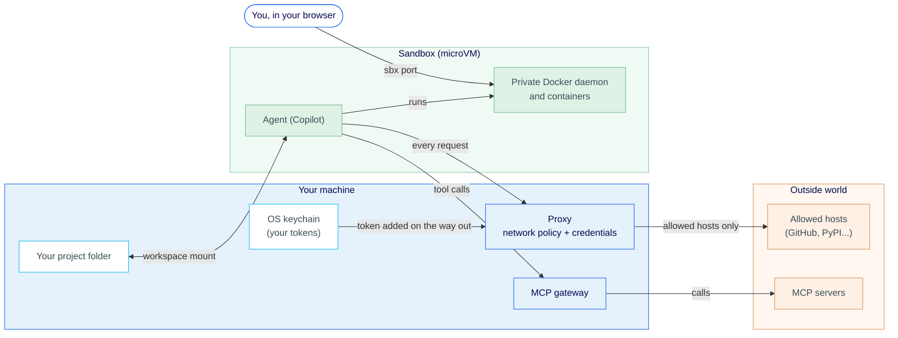

# Docker Sandboxes with GitHub Copilot Lab

👋 Welcome to the **Docker Sandboxes with GitHub Copilot Lab**!

In this hands-on lab you will use GitHub Copilot inside a [Docker Sandbox](https://docs.docker.com/ai/sandboxes/) to work on **DevBoard**, a small issue tracker (FastAPI + Next.js) located in the [`project/`](project/) folder. Along the way you will see how sandboxes keep your machine, your files and your credentials safe while an AI agent does real work.

**Duration:** about 100 minutes, plus the prerequisites, which you do beforehand.

## What you will learn

- Control what an agent can reach on the network with **network policies**
- Understand how **kits** define an agent's sandbox, and build your own
- Give an agent access to services without ever exposing your **credentials**
- Run an agent in **direct mode** and in isolated **clone mode**, and run several agents **in parallel**
- Monitor sandboxes from the **TUI dashboard**
- Run **Docker inside a sandbox** and reach it from your browser with **port forwarding**
- Give your agent tools through the sandbox's **MCP gateway**

## How a sandbox works

A Docker Sandbox is not a container: it's a lightweight **microVM**, with its own kernel, that runs one AI agent. Everything the agent can touch on the way out goes through a few doors that you control from your machine.



| Door | What it means | Module |
|------|---------------|--------|
| **Network proxy** | Every outbound request leaves through a proxy on your machine, which allows or blocks it by host | [01](instructions/01-network-policies.md) |
| **Kit** | A YAML file that says which image the sandbox runs, how the agent starts and what it's given | [02](instructions/02-kits.md) |
| **Credential injection** | Your tokens stay in your OS keychain; the proxy adds them to the agent's requests, so the agent only ever sees a placeholder | [03](instructions/03-secrets-credentials.md), [04](instructions/04-first-sandbox.md) |
| **Workspace** | Only the folder you give the sandbox is shared with it, not the rest of your disk; or the agent gets a private Git clone instead | [04](instructions/04-first-sandbox.md), [07](instructions/07-parallel-agents.md) |
| **Private Docker daemon** | Containers the agent starts live inside the microVM, invisible to your host's Docker | [08](instructions/08-docker-inside-the-sandbox.md) |
| **Port publishing** | Nothing inside is reachable from your machine until you publish a port | [09](instructions/09-port-forwarding.md) |
| **MCP gateway** | Tools reach the agent through the gateway, without opening its network. The MCP servers run outside the sandbox, so its network policy doesn't apply to them: register only servers you trust | [10](instructions/10-mcp-servers.md) |

Because the agent can't step outside these doors, you can let it work without approving every command (`--yolo`), and still know what it can and can't reach.

## Table of contents

| #  | Module | You will... | Time |
|----|--------|-------------|------|
| 00 | [Prerequisites](instructions/00-prerequisites.md) | Check your accounts and tools | **before the lab** |
| 01 | [Network policies](instructions/01-network-policies.md) | Start your first sandbox, lock the network down, and see how kits allow what each sandbox needs | 10 min |
| 02 | [Kits](instructions/02-kits.md) | See how an agent's sandbox is defined, and build a kit | 8 min |
| 03 | [Secrets and credentials](instructions/03-secrets-credentials.md) | Store a token the agent can use but never read | 3 min |
| 04 | [Agent sandbox](instructions/04-first-sandbox.md) | Create your agent's sandbox, check its isolation, and meet your agent | 12 min |
| 05 | [TUI dashboard](instructions/05-tui-dashboard.md) | Monitor sandboxes and network activity | 3 min |
| 06 | [Run in direct mode](instructions/06-run-in-direct-mode.md) | Let the agent fix failing tests in your working tree | 12 min |
| 07 | [Clone mode and parallel agents](instructions/07-parallel-agents.md) | Run isolated agents side by side and merge their work | 20 min |
| 08 | [Docker inside the sandbox](instructions/08-docker-inside-the-sandbox.md) | Start the full app with Docker Compose in a sandbox | 8 min |
| 09 | [Port forwarding](instructions/09-port-forwarding.md) | Open the app running in the sandbox in your browser | 5 min |
| 10 | [MCP servers](instructions/10-mcp-servers.md) | Give your agent a tool without opening its network, then scan the images it suggests | 12 min |
| 11 | [Cloud sandboxes](instructions/11-cloud-sandboxes.md) | *Optional, paid:* run the same agent on Docker's infrastructure, and share its app with a public URL | 20 min |
| 12 | [Wrap up](instructions/12-wrap-up.md) | Clean up and find out where to go next | 3 min |

Stuck? See [Troubleshooting](instructions/troubleshooting.md).

## Getting started

1. Clone the repository:

    ```bash id=host
    git clone https://github.com/mathieu-benoit/sbx-lab
    cd sbx-lab
    ```

    You commit the agents' work locally during the lab, but you never push it, so you don't need a fork.

2. Complete the [prerequisites](instructions/00-prerequisites.md) **before the lab**: they download several hundred megabytes, which is slow on shared Wi-Fi.

3. Follow the modules in order.

Enjoy!

[[Next >> Prerequisites](instructions/00-prerequisites.md)]
