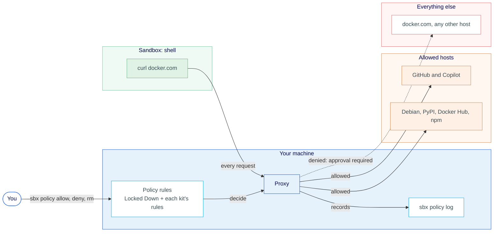

# 🔒 Network policies

Every sandbox routes outbound HTTP/HTTPS through a host-side proxy that enforces access rules you define. There are three built-in postures:

| Policy      | Description                                                                          |
|-------------|--------------------------------------------------------------------------------------|
| Open        | All traffic allowed — no restrictions                                                |
| Balanced    | Default deny, with a broad allow-list covering AI APIs, npm, pip, GitHub, registries |
| Locked Down | Everything blocked; you explicitly allow what you need                               |

In this lab you will use **Locked Down**, and let each sandbox's kits allow only the hosts its exercises need.



To view the existing policies, use the `sbx policy ls` command:

```bash id=host
sbx policy ls
```

## Test the `Locked Down` network policies profile

Run this command to set the default:

> [!WARNING]
> `sbx policy reset` **deletes every network rule you have created on this machine**, not only the lab's. If you use `sbx` for other work, save your current rules first with `sbx policy ls` and re-add them afterwards.

```bash id=host
sbx policy reset
```

The CLI restarts the daemon, resets the policies, and shows a picker. Choose the **Locked Down** option (all network traffic is blocked unless you allow it).

> [!TIP]
> To do the same without the interactive picker, run these two commands:
>
> ```bash id=host
> sbx policy reset --force
> ```
>
> ```bash id=host
> sbx policy init deny-all
> ```

Check the configured policies:

```bash id=host
sbx policy ls
```

You should now see this:

```none id=host
  POLICY             SOURCE   APPLIES TO   SUMMARY
  default-deny-all   local    all          network: deny when no rule decides
  local-policy       local    all          filesystem read: 1 allow; filesystem write: 1 allow
```

Check whether `docker.com` is reachable under this policy:

```bash id=host
sbx policy check network docker.com
```

You will see this message:

```none id=host
    Denied:      docker.com:443
    Governance:  Local policy only
    Context:     global
    Reason:      no matching allow rule (default deny)
```

Now start your **first sandbox**: a microVM with just a shell, no agent yet. The current folder is its workspace, and `--name` gives it a name you will reuse when you clean up:

```bash id=host
sbx run shell --name shell-demo
```

Your prompt changes: you're now inside the sandbox. Try to reach `docker.com` from there:

```bash id=sandbox
curl docker.com
```

You will see this message:

```none id=sandbox
Approval required for docker.com:80.

Review and respond with:
  sbx policy approval ls
```

The request never left your machine: the host-side proxy blocked it and filed a **pending approval**. You could grant it from the host with `sbx policy approval`, or from the [TUI dashboard](05-tui-dashboard.md). The difference: **approving** answers this one request, while **allowing** (`sbx policy allow network`) adds a rule that applies to every sandbox from then on. In this module you'll add a rule. Adding it doesn't answer the pending approval: it stays in `sbx policy approval ls` until you respond to it or remove the sandbox, so don't be surprised to see it again in the dashboard.

Exit this sandbox to return to your host:

```bash id=sandbox
exit
```

## See what the sandbox is hitting

To view a list of the hosts that were allowed or blocked by the proxy, use the `sbx policy log` command:

```bash id=host
sbx policy log
```

You should see output similar to the following:

```none id=host
  BLOCKED REQUESTS
  SANDBOX           TYPE      HOST                                         PROXY     RULE                                                                                                                    REASON                                  LAST SEEN        COUNT
  shell-demo        network   docker.com:80                                forward   no applicable policies for op(action=net:connect:tcp, resource=net:domain:docker.com:80)                                No matching allow rule (default deny)   11:03:48 7-Nov   2
```

Adding the `--json` flag will output the log details in a machine-readable JSON format.

## Allow additional hosts

As you can see, the list of allowed hosts is small to begin with. However, it is easy to modify the list.

Use the `sbx policy allow network` command to allow communication with `docker.com`:

```bash id=host
sbx policy allow network docker.com
```

Check `docker.com` again:

```bash id=host
sbx policy check network docker.com
```

You will see this message:

```none id=host
    Allowed:     docker.com:443
    Governance:  Local policy only
    Context:     global
    Rule:        e3246d5b-cb8e-42d5-879d-45efeb4b2a4a
```

The `Rule` line names the rule that allowed the request: it's the ID that `sbx policy allow network` printed when it added the rule (`Added rule e3246d5b-… to policy local`). Yours is different.

Reconnect to the sandbox:

```bash id=host
sbx run --name shell-demo
```

Once in the sandbox, try to reach `docker.com` again, showing only the response headers:

```bash id=sandbox
curl -I docker.com
```

This time `docker.com` answers itself, with a `301 Moved Permanently` redirect to HTTPS, instead of the proxy's approval message. Type `exit` to return to your host.

> [!TIP]
> You can allow several hosts in a single command, and use wildcards: `*.example.com` matches exactly one subdomain level (`api.example.com`), `**.example.com` matches any depth (`api.eu.example.com`). Neither matches `example.com` itself.
>
> ```bash id=host
> # Allow several hosts at once
> sbx policy allow network "smtp.mailgun.org,api.sendgrid.com"
>
> # Allow every subdomain of npmjs.org, at any depth
> sbx policy allow network "**.npmjs.org"
> ```

## Block a host

To explicitly block a host, use the `sbx policy deny` command:

```bash id=host
sbx policy deny network ads.example.com
```

## Removing custom policies

Each rule you define manually is stored separately. To remove them, use the `sbx policy rm` command, and confirm when it asks (add `--force` to skip the question):

1. Remove the allow rule for `docker.com`:

    ```bash id=host
    sbx policy rm network --resource docker.com
    ```

2. Remove the deny rule for `ads.example.com`:

    ```bash id=host
    sbx policy rm network --resource ads.example.com
    ```

## Reaching host services from inside the sandbox

If you have a service running on your host machine (for example a local Ollama instance or a database), you can't reach it via `localhost` from inside the sandbox, because `localhost` there is the sandbox itself.

Inside the sandbox, use the name `host.docker.internal`, which the proxy routes to your host. The policy rule, on the other hand, names the service as your host sees it, `localhost:<port>`: you decide which ports of your own machine are reachable, one by one. You don't need to run this command for the lab:

```bash id=host
sbx policy allow network localhost:11434
```

Then inside the sandbox, point your client at `host.docker.internal:11434`.

## Keep Locked Down for the rest of the lab

You keep the **Locked Down** policy for the rest of the lab, without adding any host to it: rather than trusting a broad allow list, each sandbox gets exactly the hosts its **kits** declare, for that sandbox only. You'll read those kits in the next module.

1. Check your policy. You removed the rules you added above, so it's back to Locked Down, with no network rule of your own:

    ```bash id=host
    sbx policy ls
    ```

    ```none id=host
    POLICY             SOURCE   APPLIES TO   SUMMARY
    default-deny-all   local    all          network: deny when no rule decides
    local-policy       local    all          filesystem read: 1 allow; filesystem write: 1 allow
    ```

2. Check a host your agents will use:

    ```bash id=host
    sbx policy check network api.github.com
    ```

    ```none id=host
      Denied:      api.github.com:443
      Governance:  Local policy only
      Context:     global
      Reason:      no matching allow rule (default deny)
    ```

    `sbx policy check` reads your global policy, which allows nothing. `api.github.com` will only be reachable from the sandboxes whose kits allow it, such as every Copilot sandbox.

Here are the hosts the lab needs, and the kit that brings each of them:

| Hosts | Used for | Declared by | Module |
|-------|----------|-------------|--------|
| `github.com`, `api.github.com`, `api.*.githubcopilot.com`, `copilot.github.com` | The Copilot agent, and the GitHub API | The Copilot kit, `sbx/copilot` | All agent modules |
| `deb.debian.org:80`, `dhi.io:80` | The sandbox image's `apt` repositories (Debian and Docker Hardened Images), to install Python | The DevBoard kit, during the install | [Agent sandbox](04-first-sandbox.md) |
| `pypi.org`, `files.pythonhosted.org` | The backend's Python packages | The DevBoard kit | [Run in direct mode](06-run-in-direct-mode.md), [Clone mode](07-parallel-agents.md), [Docker inside the sandbox](08-docker-inside-the-sandbox.md) |
| `**.docker.io`, `production.cloudfront.docker.com` | Pulling the `python`, `node` and `postgres` images, and the images Trivy and Docker Scout read | The DevBoard kit | Docker inside the sandbox, [MCP servers](10-mcp-servers.md) |
| `dhi.io:443` | The Docker Hardened Images registry, read by Trivy and Docker Scout | The DevBoard kit | MCP servers |
| `registry.npmjs.org` | The frontend's npm packages | The DevBoard kit | Docker inside the sandbox |
| `mirror.gcr.io`, `ghcr.io`, `raw.githubusercontent.com`, `codeload.github.com`… | Trivy's vulnerability database, and the VEX statements | The Trivy kit | MCP servers |
| `api.dso.docker.com`, `api.scout.docker.com` | The Docker Scout service | Docker's Scout kit, `sbx/scout-cli` | MCP servers |

Every host is on port 443 (HTTPS), except the `apt` repositories: the sandbox image reads `deb.debian.org` and `dhi.io` over plain HTTP, on port 80. `dhi.io` gets both ports, `:80` for its packages and `:443` for its image registry. A rule without a port would allow the host on any port.

> [!NOTE]
> Copilot also calls telemetry hosts, such as `telemetry.*.githubcopilot.com` and `cafe.github.com`, that no kit allows. They show as blocked in `sbx policy log`, and Copilot works without them.

> [!TIP]
> If an agent later fails to download something, run `sbx policy log` to see the blocked host. Then allow it for that sandbox only, with `sbx policy allow network <host> --sandbox <name>`, or add it to the kit that needs it.

[[<< Previous: Prerequisites](00-prerequisites.md) | [Next >> Kits](02-kits.md)]
