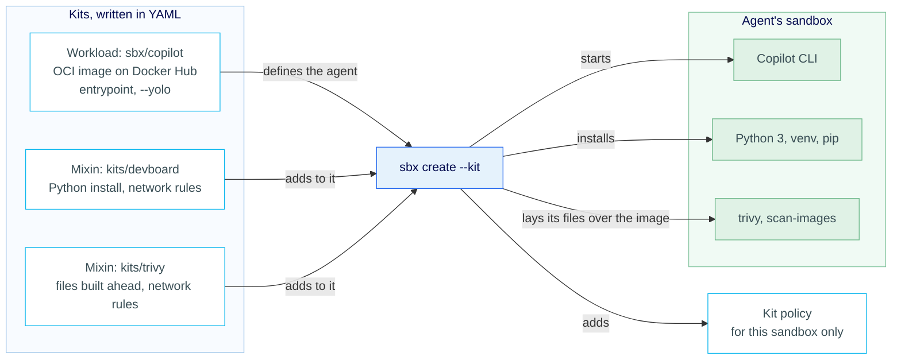

# 🧩 Kits

Every agent you'll run in this lab comes from a **kit**. A kit is a declarative YAML artifact, published to a registry like an image, that describes an agent's sandbox: which image runs, how the agent starts, and what it is given (credentials, network policies, environment variables, startup commands and files).

Because all of that lives in one versioned artifact, the agent's environment, and the authority it gets, is reproducible and reviewable: a change in what an agent is allowed to do shows up as a change in its kit.

Kits use the **v3** format: a YAML descriptor that starts with `# syntax=docker/sandbox-kit:3` and `schemaVersion: "3"`, often next to a Dockerfile. There are two kinds of kits:

| Kind | What it does | Example |
|------|--------------|---------|
| Workload (`kind: workload`) | Defines what runs, here the agent: its image, entrypoint, default arguments, and what it needs | `sbx/shell`, `sbx/copilot`, `sbx/claude`, OCI images on Docker Hub |
| Mixin (`kind: mixin`) | Extends a workload with a tool, a credential, a network rule, a file… | `sbx/scout-cli`, or your own; added with `sbx create <agent> --kit <reference>` |



Run the commands of this module from the root of the repository.

## Inspect the Copilot kit

1. Show a summary of the kit that `sbx run copilot` uses:

    ```bash id=host
    sbx kit inspect sbx/copilot
    ```

    ```none id=host
      Name:               copilot
      Kind:               sandbox
      Schema:             v3
      Display:            GitHub Copilot
      Description:        GitHub Copilot CLI, GitHub's agentic coding CLI.
      Binary:             copilot
      Template:           docker.io/sbx/copilot@sha256:9e062b87...
      Run Options:        --yolo
      Arguments:
        model:            Copilot model to use (settings.json `model`); empty keeps the CLI default (default "", matching ^[A-Za-z0-9._/:-]*$)
        reasoningEffort:  Reasoning effort (settings.json `effortLevel`); empty keeps the model default (default "", one of "", "none", "minimal", "low", "medium", "high", "xhigh", "max")
      Policies:
        Environment:      2 variables, 0 proxy-managed
    ```

2. Show the kit's declaration itself:

    ```bash id=host
    sbx kit inspect sbx/copilot --format yaml
    ```

    ```yaml id=host
    schemaVersion: "3"
    kind: sandbox
    name: copilot
    displayName: GitHub Copilot
    description: GitHub Copilot CLI, GitHub's agentic coding CLI.
    sourceURL: https://github.com/docker-hardened-images/definitions
    licenses:
    - LicenseRef-Proprietary
    args:
      model:
        default: ""
        description: Copilot model to use (settings.json `model`); empty keeps the CLI default
        pattern: ^[A-Za-z0-9._/:-]*$
      reasoningEffort:
        default: ""
        description: Reasoning effort (settings.json `effortLevel`); empty keeps the model default
        enum:
        - ""
        - none
        - minimal
        - low
        - medium
        - high
        - xhigh
        - max
    sandbox:
      image: docker.io/sbx/copilot@sha256:9e062b87...
      entrypoint:
      - copilot
      command:
        default:
        - --yolo
    environment:
      variables:
        COPILOT_KIT_MODEL: ""
        COPILOT_KIT_REASONING_EFFORT: ""
    ```

> [!NOTE]
> `sbx kit inspect` shows a kit as `sbx` reads it, not its source file. `sbx` v0.54 prints a workload as `Kind: sandbox`, with a `sandbox:` block for its image, entrypoint and command. In a v3 kit's source, these come from the Dockerfile next to the `kind: workload` descriptor: `FROM` sets the image, and `ENTRYPOINT` and `CMD` set the entrypoint and the default command.

It's a small file, and it tells you a lot about the sandboxes you'll use in this lab:

| In the kit | What it means | Where you'll see it |
|------------|---------------|---------------------|
| `sandbox.image`, pinned by digest, built from Docker Hardened Images (`sourceURL`) | The sandbox's image: a minimal Debian image with the `agent` user and Docker, but no Python | [Agent sandbox](04-first-sandbox.md): you add Python with the kit you build below |
| `entrypoint: copilot` | `sbx run` starts the Copilot CLI | [Agent sandbox](04-first-sandbox.md) |
| `command.default: --yolo` | Copilot runs without asking for confirmations; arguments you pass after `--` are added to it | [Agent sandbox](04-first-sandbox.md), [Clone mode and parallel agents](07-parallel-agents.md) |
| `args`: `model` and `reasoningEffort`, empty by default | Settings you can choose when you create a sandbox, with `--kit-arg` | [Choose the model and the reasoning effort](#choose-the-model-and-the-reasoning-effort), below |
| `environment`: `COPILOT_KIT_MODEL`, `COPILOT_KIT_REASONING_EFFORT` | Two variables set inside the sandbox, which carry the arguments' values | [Choose the model and the reasoning effort](#choose-the-model-and-the-reasoning-effort), below |
| No network rules (`Policies` lists only the environment variables) | The descriptor declares no network rules. `sbx` still allows Copilot's own core hosts for each Copilot sandbox, on top of the rules you added in [Network policies](01-network-policies.md) | [Agent sandbox](04-first-sandbox.md), with `sbx policy ls` |

## Choose the model and the reasoning effort

The kit's `args` are settings of the kit itself, which you choose when you create a sandbox, with `--kit-arg <name>=<value>` (see the [`sbx/copilot` page on Docker Hub](https://hub.docker.com/r/sbx/copilot)):

- `model`: the Copilot model, such as `claude-sonnet-5.5` or `gpt-5.6-sol`. It must be available on your Copilot plan.
- `reasoningEffort`: how much the model reasons before it answers: `none`, `minimal`, `low`, `medium`, `high`, `xhigh` or `max`, if the model supports that level.

Both are empty by default, which keeps Copilot's own defaults, and this lab keeps them. To choose them, you add `--kit-arg` flags to `sbx create`, for example:

- `--kit-arg model=claude-sonnet-5.5` picks the model.
- `--kit-arg reasoningEffort=high` raises the reasoning effort.
- With several kits, as in [Agent sandbox](04-first-sandbox.md), where the DevBoard kit comes with the Copilot kit, prefix each name with the kit's: `--kit-arg copilot.model=claude-sonnet-5.5`, `--kit-arg copilot.reasoningEffort=high`.

When the sandbox is created, the kit sets the two `environment` variables to the values you chose and writes them into Copilot's settings, `~/.copilot/settings.json` (`model` and `effortLevel`). Copilot then starts with this model and this effort in every session of the sandbox, and `/model` still changes them during a session. Kit arguments configure the kit, not the agent's command line: what you pass after `--`, as in [Clone mode and parallel agents](07-parallel-agents.md), goes to Copilot itself and is added to `--yolo`.

## The built-in agent kits are OCI images

The kits that come with Docker Sandboxes, agents and mixins alike, are published on Docker Hub, in the `sbx` namespace, as regular **OCI images**: the same format as any container image, and multi-platform (`linux/amd64` and `linux/arm64`). The agent kits are built from Docker Hardened Images.

| Kit | Kind | What it runs or adds | Docker Hub |
|-----|------|----------------------|------------|
| `sbx/shell` | `workload` | A plain shell, no agent | [hub.docker.com/r/sbx/shell](https://hub.docker.com/r/sbx/shell) |
| `sbx/copilot` | `workload` | GitHub Copilot CLI | [hub.docker.com/r/sbx/copilot](https://hub.docker.com/r/sbx/copilot) |
| `sbx/claude` | `workload` | Claude Code | [hub.docker.com/r/sbx/claude](https://hub.docker.com/r/sbx/claude) |
| `sbx/scout-cli` | `mixin` | The Docker Scout CLI, added to an agent's sandbox | [hub.docker.com/r/sbx/scout-cli](https://hub.docker.com/r/sbx/scout-cli) |

You'll add the `sbx/scout-cli` mixin with `--kit sbx/scout-cli` in [MCP servers](10-mcp-servers.md#compare-the-images-with-docker-scout), to compare images with Docker Scout.

So the `image` you saw in the kit, `docker.io/sbx/copilot@sha256:9e062b87...`, is the image on [hub.docker.com/r/sbx/copilot](https://hub.docker.com/r/sbx/copilot), pinned by the digest of its image index. Kits are distributed, versioned, pinned and cached like images, through the same registries, which is also how you can share your own kits, with `sbx kit push` (see [Build your own kit](#build-your-own-kit)).

If you have the Docker CLI on your host, you can see it for yourself (optional):

```bash id=host
docker buildx imagetools inspect sbx/copilot:latest
```

```none id=host
Name:      docker.io/sbx/copilot:latest
MediaType: application/vnd.oci.image.index.v1+json
Digest:    sha256:9e062b8791ec1ef5bc6a482c35bca217c07f78597a0bb0659fad05d14029aa4b

Manifests:
  Name:        docker.io/sbx/copilot:latest@sha256:2bf4b18c...
  MediaType:   application/vnd.oci.image.manifest.v1+json
  Platform:    linux/arm64
  ...
  Name:        docker.io/sbx/copilot:latest@sha256:3a2aa5c6...
  MediaType:   application/vnd.oci.image.manifest.v1+json
  Platform:    linux/amd64
  ...
```

The digest of the `latest` tag is the one pinned in the kit, and the index holds one image per platform.

## Compare with another agent kit

Kits describe every agent the same way. Inspect the Claude Code kit:

```bash id=host
sbx kit inspect sbx/claude
```

It's described the same way, with one more part of the format:

- The same **arguments**, `model` and `reasoningEffort`, with Claude's own values: its `reasoningEffort` also accepts `auto`, for example. You set them with `--kit-arg` too.
- The same two **environment variables** (`Policies: Environment: 2 variables`), which carry them.
- An **AI file** (`/home/agent/.claude/CLAUDE.md`), where context for the agent is placed.

## Build your own kit

Writing a kit is mostly writing YAML. The DevBoard project includes a small mixin, [`project/kits/devboard/devboard.yaml`](../project/kits/devboard/devboard.yaml), with what DevBoard needs in an agent's sandbox: Python, so your agent doesn't have to install it by hand, and the hosts DevBoard's builds and scans reach.

```yaml id=host
# syntax=docker/sandbox-kit:3
schemaVersion: "3"
kind: mixin
displayName: DevBoard
description: What DevBoard needs in a sandbox, Python 3 with venv and pip, and the hosts its builds and scans reach

capabilities:
  # Install Python once, as root, when the sandbox is created.
  - type: com.docker.sandbox/lifecycle@1
    config:
      install:
        - description: Install Python 3, venv and pip
          user: "0"
          command: apt-get update && apt-get install -y --no-install-recommends python3 python3-venv python3-pip

  # Only the hosts DevBoard needs. For the install: the sandbox image's apt
  # repositories (Debian and Docker Hardened Images), which apt-get update reads.
  # At runtime: PyPI, for pip; Docker Hub, for the python, node and postgres
  # images that Docker Compose pulls and for the images Trivy and Docker Scout
  # read; the Docker Hardened Images registry; and npm, for the frontend.
  - type: com.docker.sandbox/network-policy@1
    config:
      install:
        allow: [deb.debian.org:80, dhi.io:80]
      runtime:
        allow:
          - pypi.org:443
          - files.pythonhosted.org:443
          - "**.docker.io:443"
          - production.cloudfront.docker.com:443
          - dhi.io:443
          - registry.npmjs.org:443
```

It declares two capabilities: a **lifecycle** hook that runs once when the sandbox is created, and a **network policy** that opens only the hosts this kit needs. For the install, that's the sandbox image's apt repositories, `deb.debian.org` and `dhi.io` (Docker Hardened Images), on port 80 because `apt` reads them over HTTP, and because `apt-get update` reads every configured source. At runtime, on port 443: PyPI for `pip`, Docker Hub and its download host for the images Docker Compose pulls and the scanners read, the Docker Hardened Images registry, `dhi.io`, and npm for the frontend. These are the lab's hosts: with them in the kit, your own policy stays Locked Down, with no rule of your own. No Dockerfile is needed for this one.

> [!NOTE]
> The `install` and `runtime` lists say when each host is needed. Once the sandbox runs, `sbx policy inspect` shows only the `runtime` hosts in its kit policy. In a Copilot sandbox the kit policy also lists `deb.debian.org:80` and `dhi.io:80`: they come from the Copilot agent, not from this kit.

1. Check that the kit is valid:

    ```bash id=host
    sbx kit validate ./project/kits/devboard
    ```

    ```none id=host
      ✓ ./project/kits/devboard — valid (directory)
    ```

2. See what it declares:

    ```bash id=host
    sbx kit inspect ./project/kits/devboard
    ```

    ```none id=host
      Name:         devboard
      Kind:         mixin
      Schema:       v3
      Display:      DevBoard
      Description:  What DevBoard needs in a sandbox, Python 3 with venv and pip, and the hosts its builds and scans reach
      Template:     sbx-kit-src:devboard-e268c422e3de
      Policies:
        Network:    6 allow, 0 deny
        Commands:   1 install, 0 startup, 0 init files
    ```

You'll add this kit to every sandbox your agents work in, from [Agent sandbox](04-first-sandbox.md) on.

To share a kit, publish it in a Git repository or an OCI registry (`sbx kit push`). Remote kits are only installed from trusted publishers: `sbx` checks each reference against the `kit.allowedSources` setting (see `sbx settings get kit.allowedSources`). For example, if you published this kit in your own GitHub repository, someone using it as `--kit "git+https://github.com/<YOUR-GITHUB-USERNAME>/<REPOSITORY>.git#dir=kits/devboard"` must first allow `github.com/<YOUR-GITHUB-USERNAME>/` there.

## A kit with its own image: Trivy

The DevBoard kit installs its tool when the sandbox is created, so its network policy must open the Debian hosts during that install. A kit can also bring a Dockerfile and install its tools **when the kit itself is built**, on your machine, before any sandbox exists. The project includes a second mixin made that way, [`project/kits/trivy/`](../project/kits/trivy/), adapted from Docker's [trivy-mixin kit](https://github.com/docker/sbx-kits-contrib/tree/v3/trivy-mixin). It adds [Trivy](https://trivy.dev/), Aqua's open source vulnerability scanner, to an agent's sandbox:

```yaml id=host
# syntax=docker/sandbox-kit:3
schemaVersion: "3"
kind: mixin
displayName: Trivy
description: Aqua's open source vulnerability scanner, added to an agent's sandbox
sourceUrl: https://github.com/aquasecurity/trivy

provides: ["trivy@0.70.0"]

capabilities:
  - type: com.docker.sandbox/network-policy@1
    config:
      runtime:
        allow:
          - mirror.gcr.io:443
          - ghcr.io:443
          - pkg-containers.githubusercontent.com:443
          - github.com:443
          - api.github.com:443
          - codeload.github.com:443
          - raw.githubusercontent.com:443
```

The first three hosts serve Trivy's vulnerability database. The GitHub hosts serve [VEX](https://docs.docker.com/dhi/explore/security-concepts/vex/) statements, which mark the CVEs that don't affect an image, including those published for Docker Hardened Images.

Next to it, [`trivy.dockerfile`](../project/kits/trivy/trivy.dockerfile) builds the kit's image in two stages. The first starts from the sandbox template, downloads Trivy 0.70.0, and checks the download against the SHA256 published for each architecture. The second starts from an empty image (`scratch`) and keeps only the files the mixin adds: the `trivy` binary, and two files from the kit's folder, [`scan-images.sh`](../project/kits/trivy/scan-images.sh), a helper that prints one summary line per scanned image, and [`vex-repository.yaml`](../project/kits/trivy/vex-repository.yaml), which tells Trivy where to find the VEX statements. When you add the mixin to an agent, `sbx` lays these files over the agent's image:

```dockerfile
# syntax=docker/dockerfile:1
FROM docker/sandbox-templates:shell-docker AS build

ARG TRIVY_VERSION=0.70.0
ARG TARGETARCH

USER root
RUN set -eu; \
    case "${TARGETARCH}" in \
      amd64) \
        tarball="trivy_${TRIVY_VERSION}_Linux-64bit.tar.gz"; \
        sha256=8b4376d5d6befe5c24d503f10ff136d9e0c49f9127a4279fd110b727929a5aa9 ;; \
      arm64) \
        tarball="trivy_${TRIVY_VERSION}_Linux-ARM64.tar.gz"; \
        sha256=2f6bb988b553a1bbac6bdd1ce890f5e412439564e17522b88a4541b4f364fc8d ;; \
      *) echo "unsupported TARGETARCH: ${TARGETARCH} (expected amd64 or arm64)" >&2; exit 1 ;; \
    esac; \
    curl --proto '=https' --tlsv1.2 -fsSL -o /tmp/trivy.tgz \
      "https://github.com/aquasecurity/trivy/releases/download/v${TRIVY_VERSION}/${tarball}"; \
    echo "${sha256}  /tmp/trivy.tgz" | sha256sum -c -; \
    mkdir -p /out/usr/local/bin; \
    tar -C /out/usr/local/bin -xzf /tmp/trivy.tgz trivy; \
    rm /tmp/trivy.tgz; \
    chmod 0755 /out/usr/local/bin/trivy; \
    chown 0:0 /out/usr/local/bin/trivy; \
    /out/usr/local/bin/trivy --version

FROM scratch
COPY --from=build /out /
COPY --chmod=0755 scan-images.sh /usr/local/bin/scan-images
COPY vex-repository.yaml /usr/local/share/trivy/vex-repository.yaml
```

Compared with the DevBoard kit, both are mixins, but:

| | DevBoard kit | Trivy kit |
|---|---|---|
| Installs its tool | When the sandbox is created (`lifecycle` hook running `apt-get`) | When the kit is built (`trivy.dockerfile`), pinned by version and SHA256 |
| Adds to the sandbox | Packages, installed inside each new sandbox | A layer of files, laid over the agent's image |
| Network policy | Debian hosts for the install; PyPI, Docker Hub, `dhi.io` and npm at runtime | Trivy's vulnerability database and the VEX statements, at runtime only |

Why put a scanner in a sandbox? It reads all your code, and it's a supply-chain target like any other tool: Trivy's own releases were compromised in March 2026. In a sandbox, it sees the workspace but not your `~/.ssh` or `~/.docker/config.json`, and it can reach its database, the VEX statements and the hosts its sandbox's other kits allow, nothing else.

You'll add this kit to an agent's sandbox in [MCP servers](10-mcp-servers.md), to scan DevBoard's base images before and after switching them to Docker Hardened Images.

The next two sections show two more ways to package what you just did. They're here so you know they exist: you don't need to run them, and the rest of the lab doesn't use them.

## Combine kits into a kit set

In this lab you add mixins to the Copilot kit with `--kit` each time you create a sandbox: the DevBoard kit, and in [MCP servers](10-mcp-servers.md), the Trivy kit. A [kit set](https://docs.docker.com/ai/sandboxes/customize/author/kit-sets/) (Early Access) packages such a combination as a single kit, so your team runs one reference, with the versions you chose:

```yaml id=host
# syntax=docker/sandbox-kit:3
schemaVersion: "3"
kind: set
displayName: Copilot with Python and Trivy
version: "1.0.0"

kits:
  - ref: docker.io/sbx/copilot@sha256:<DIGEST>          # the workload you inspected above
  - ref: docker.io/<NAMESPACE>/devboard-kit:1.0.0         # the DevBoard mixin, once published
  - ref: docker.io/<NAMESPACE>/trivy-kit:1.0.0          # the Trivy mixin, once published
```

- A set lists its components under `kits:`: at most one workload (the agent) and any number of mixins.
- Every component must be **published** to a registry. Local paths such as `./kits/devboard` aren't accepted, so you'd publish the Python and Trivy mixins first.
- Each component keeps its own content and rules: the DevBoard kit still installs Python when the sandbox is created, and the Trivy kit still brings its files and its network rules for the vulnerability database and the VEX statements. The set only adds what the combination needs on top, with the same `capabilities:` as a mixin.
- You build and publish a set with Docker Buildx, `docker buildx build ./copilot-tools -f ./copilot-tools/copilot-tools.yaml -t docker.io/<NAMESPACE>/copilot-tools:1.0.0 --push`, then run it like any agent: `sbx run docker.io/<NAMESPACE>/copilot-tools:1.0.0 --name quickstart`. No `--kit` needed.

A sandbox created from a set is the same as one created from its kits. The set keeps its kits' layers as they are, so it downloads the same bytes and shares the same local cache, and the same install hooks run at create, and the same startup hooks at every start. What changes is when the work happens:

| | Separate kits (one `--kit` each) | A kit set |
|-|----------------------------------|-----------|
| Checking that the kits fit together (`requires`, `conflicts`, arguments) | Each time a sandbox is created | Once, when the set is published: a combination that doesn't fit can't be published |
| Looking up the kits | One lookup per kit | One reference |
| Assembling the sandbox's image | By `sbx`, when the sandbox is created | When the set is published: the set is one image |
| Versions | Each tag, such as `:latest`, resolves when the sandbox is created | Pinned by digest when the set is built |
| Two kits that ship the same file | Creating the sandbox fails | The later layer wins, decided when the set is published |

Creating a sandbox may be a little faster from a set, with one lookup, no check and no assembly. But that's metadata work, seconds at most: downloading the layers and starting the VM take most of the time, and they're the same both ways. Once the sandbox exists, every start is identical. So a set is about one reference and a combination checked and pinned once, not about speed.

## Describe a sandbox in an environment file

A kit packages tools. An [environment file](https://docs.docker.com/ai/sandboxes/configuration/environment-files/) (`sbxenv.yaml`, experimental) describes a whole sandbox instead: the agent and its kits, the workspace, the secrets, the published ports, MCP servers, and commands to run on your host. Commit it with the project, and every contributor gets the same sandbox without retyping flags.

The repository doesn't include one, but this file, saved as `sbxenv.yaml` at the root of the repository, would gather the setup you'll do step by step in the next modules:

```yaml id=host
schemaVersion: "1"
name: quickstart
agent: copilot
workspace: ./project          # the folder shared with the sandbox (module 04)

kits:
  - ./project/kits/devboard     # the DevBoard mixin from this module

secrets:                      # the GitHub token (module 03), stored for this sandbox only
  github:
    command: gh auth token
  copilot:
    command: gh auth token

ports:                        # the published ports (module 09)
  - sandbox: 8000
    host: 8000
  - sandbox: 3000
    host: 3001
```

- `sbx env plan` shows what the file would create, without applying anything. `sbx env run` creates the sandbox if needed, after you approve the plan, then attaches to the agent. `sbx env rm` removes it.
- Paths are relative to the file. Keep the file **outside** the workspace: it declares commands that run on your host, such as `gh auth token`, and the agent must not be able to change them.
- Unlike a [kit's port](09-port-forwarding.md#publish-a-port-from-a-kit), an environment file can choose the host port, because it belongs to your project rather than being shared like a kit.

## Going further

- **Extend an agent with a mixin**: `sbx run copilot --kit ./my-mixin/`. A mixin can come from a local directory, a ZIP file, a Git repository or an OCI registry.
- **Share your kits**: `sbx kit push` and `sbx kit pull` (OCI registries), and `sbx kit sign` and `sbx kit verify` to sign and check them.
- Read the [Docker Sandbox Kit specification](https://github.com/docker/sandbox-kit-spec) to see everything a kit can declare.

[[<< Previous: Network policies](01-network-policies.md) | [Next >> Secrets and credentials](03-secrets-credentials.md)]
