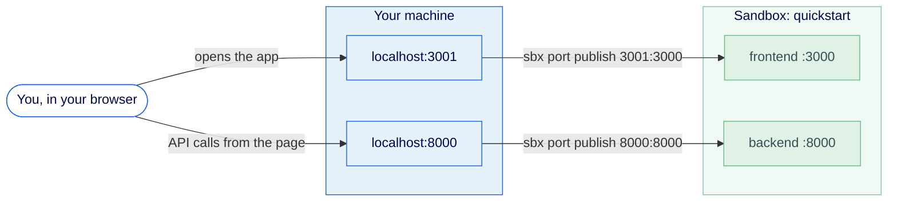
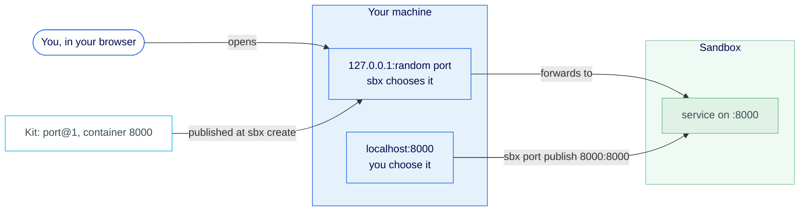

# ☎️ Port forwarding with `sbx port`

Sandboxes are network-isolated: your browser can't reach a server running inside one by default. `sbx port publish` publishes a sandbox port on a host port.



## Forward the API

1. With the Docker Compose stack from the previous module still running (the `quickstart` sandbox must be running: see `sbx ls`), run the following in a terminal on your host:

    ```bash id=host terminal-id=terminal-2
    sbx port publish quickstart 8000:8000
    ```

    You should see `Published 127.0.0.1:8000 -> 8000/tcp4`.

2. Open [http://localhost:8000/docs](http://localhost:8000/docs) to see the live Swagger UI served from inside the sandbox.

## Forward the frontend

1. Publish the sandbox's port 3000 on port 3001 of your host to reach the frontend:

    ```bash id=host terminal-id=terminal-2
    sbx port publish quickstart 3001:3000
    ```

    The syntax is `HOST_PORT:SANDBOX_PORT`. Port 3001 is used here to show that the two ports don't have to match.

2. Open [http://localhost:3001](http://localhost:3001) in your browser to see the DevBoard web front end. Click **Register** to create an account, then create a project and a few issues.

> [!NOTE]
> The browser calls the API directly at `http://localhost:8000`, which is why the API port must be published on the same port number, and why the API accepts requests from `http://localhost:3001`.

## Additional commands

1. To list the ports published by a sandbox, run `sbx port ls` with the sandbox name:

    ```bash id=host terminal-id=terminal-2
    sbx port ls quickstart
    ```

    The output looks similar to this:

    ```console id=host terminal-id=terminal-2
    HOST IP     HOST PORT   SANDBOX PORT   PROTOCOL
    127.0.0.1   3001        3000           tcp4
    127.0.0.1   8000        8000           tcp4
    ```

2. To stop publishing a port, use `sbx port unpublish`:

    ```bash id=host terminal-id=terminal-2
    sbx port unpublish quickstart 8000:8000
    ```

    With `HOST_PORT:SANDBOX_PORT`, it removes that one mapping. With only the sandbox port (`sbx port unpublish quickstart 8000`), it removes every host port mapped to it. Publish it again with `sbx port publish quickstart 8000:8000` before you move on: the frontend needs it.

> [!NOTE]
> Older guides use `sbx ports <SANDBOX> --publish` and `--unpublish`. That command still works in `sbx` v0.54 but is deprecated, and prints a warning telling you to use `sbx port` instead.

> [!IMPORTANT]
> Services inside the sandbox must listen on `0.0.0.0`, not `127.0.0.1`. Many development servers default to `127.0.0.1`, which is why the prompt in the previous module explicitly asks the agent to bind to `0.0.0.0`.

> [!IMPORTANT]
> Ports are only reachable while the sandbox is running. A sandbox stops when no agent session is attached, so keep your agent session open, or start it without a session with `sbx run --detach --name quickstart`. Published ports are restored when the sandbox restarts: while it is stopped, `sbx port ls quickstart` shows `No published ports`, and the list comes back once it runs again.

## Publish a port from a kit

`sbx port publish` publishes a port after the sandbox exists. A [kit](02-kits.md) can declare the ports its sandbox serves instead, with the `com.docker.sandbox/port@1` capability: the port is then published as soon as the sandbox is created, for everyone who uses the kit. The project includes a small mixin for the API's port, [`project/kits/api-port/api-port.yaml`](../project/kits/api-port/api-port.yaml):

```yaml id=host
# syntax=docker/sandbox-kit:3
schemaVersion: "3"
kind: mixin
displayName: DevBoard API port
description: Publishes the sandbox's port 8000, where the DevBoard API listens, to the host

capabilities:
  # Ask for the sandbox port only: sbx picks a free host port on 127.0.0.1.
  - type: com.docker.sandbox/port@1
    config:
      container: 8000
```

There's one difference with `sbx port publish`: a kit only names the **sandbox** port. The **host** port is chosen by `sbx`, a free one on `127.0.0.1`, and chosen again each time the sandbox starts. That's on purpose: a kit is shared, and two kits asking for the same host port would collide. When the host port matters, as for DevBoard's API, which the browser calls at `localhost:8000`, you still pin it yourself with `sbx port publish`.



Try it in a separate sandbox, from the `project` directory, in another terminal. It takes a couple of minutes:

1. Go to the `project` directory:

    ```bash id=host terminal-id=terminal-2
    cd project
    ```

2. Create a sandbox with the DevBoard kit and the port kit:

    ```bash id=host terminal-id=terminal-2
    sbx create --name ports-demo --kit ./kits/devboard --kit ./kits/api-port copilot .
    ```

3. Keep it running without an agent session. No agent is attached to this sandbox, so without this step it stops shortly after the `sbx exec` below, and the web server with it:

    ```bash id=host terminal-id=terminal-2
    sbx run --detach --name ports-demo
    ```

4. List its ports. You haven't published anything, yet port 8000 is already there, on a host port that `sbx` picked:

    ```bash id=host terminal-id=terminal-2
    sbx port ls ports-demo
    ```

    ```console id=host terminal-id=terminal-2
    HOST IP     HOST PORT   SANDBOX PORT   PROTOCOL
    127.0.0.1   60000       8000           tcp4
    ```

    `sbx` picks the host port again each time the sandbox starts, so list the ports after the sandbox is running.

5. Start a small web server on port 8000 in the sandbox. It serves the project folder:

    ```bash id=host terminal-id=terminal-2
    sbx exec ports-demo sh -c 'nohup python3 -m http.server 8000 >/dev/null 2>&1 &'
    ```

6. Open `http://127.0.0.1:<HOST PORT>/`, with the host port from step 4: you see the files of the `project` folder, served from inside the sandbox.

7. Remove the sandbox:

    ```bash id=host terminal-id=terminal-2
    sbx rm --force ports-demo
    ```

[[<< Previous: Docker inside the sandbox](08-docker-inside-the-sandbox.md) | [Next >> MCP servers](10-mcp-servers.md)]
