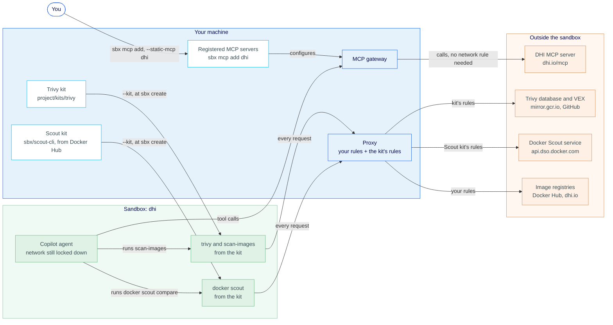

# 🧰 Give your agent tools with MCP

Your agent can only reach the hosts you allowed in the [network policies](01-network-policies.md) module. Sometimes it needs a capability rather than a website: that's what [MCP](https://modelcontextprotocol.io/) (Model Context Protocol) servers provide.

Each sandbox has an **MCP gateway**. The agent only talks to the gateway; the MCP servers you register run **outside** the sandbox, on your host or as remote services. You give the agent new tools without opening its network.

In this module you give your agent the **Docker Hardened Images (DHI)** MCP server, so it can look up a hardened alternative to an image DevBoard uses. Then you scan those images with the **Trivy kit** from the [Kits](02-kits.md#a-kit-with-its-own-image-trivy) module, and compare them with **Docker Scout**.



1. Register the DHI MCP server, from a terminal on your host:

    ```bash id=host terminal-id=terminal-2
    sbx mcp add dhi --url https://dhi.io/mcp
    ```

    If a browser window opens, sign in with your Docker account to authorize it. If `dhi` is already registered, for example from an earlier run of the lab, the command registers it again, which is safe. You can ignore the `WARN: oauth` lines it may print.

2. Check that it's registered and ready:

    ```bash id=host terminal-id=terminal-2
    sbx mcp ls
    ```

    ```none id=host
    NAME   TRANSPORT     STATUS   GATEWAY                 DETAIL
    dhi    remote http   ready    LOCAL, managed by you
    ```

3. From the `project` directory, create a dedicated sandbox, `dhi`, named after the DHI server it gets, with that server and two scanners, the Trivy kit and the Docker Scout kit:

    ```bash id=host terminal-id=terminal-2
    sbx create --name dhi --static-mcp dhi --kit ./kits/trivy --kit sbx/scout-cli copilot .
    ```

    The sandbox and the server share the name `dhi`: `--name dhi` names the sandbox, and `--static-mcp dhi` starts the sandbox's MCP gateway with **exactly this server**, and without the discovery tools an agent could use to find and add servers by itself. You decide which servers it gets. `--kit ./kits/trivy` adds the [Trivy kit](02-kits.md#a-kit-with-its-own-image-trivy) from the Kits module. The first time, `sbx` builds the kit's image, which downloads and checks Trivy (about a minute). `--kit sbx/scout-cli` adds Docker's [`sbx/scout-cli`](https://hub.docker.com/r/sbx/scout-cli) kit, published on Docker Hub as an OCI image, like the [built-in agent kits](02-kits.md#the-built-in-agent-kits-are-oci-images): the `docker scout` CLI plugin, and network rules for the Docker Scout service, for this sandbox only. You'll use both scanners at the end of this module.

    > [!NOTE]
    > The Scout kit can sign in to Docker Scout with your `sbx login`. If `sbx create` prints `WARN: required credential has no binding`, the sandbox started without your sign-in: Scout still analyzes public images, such as the ones in this module.

    Check what the gateway was given:

    ```bash id=host terminal-id=terminal-2
    sbx inspect dhi
    ```

    ```none id=host
      MCP gateway:             configured
      MCP mode:                static
      MCP servers:             dhi
    ```

    These lines describe this sandbox's gateway. `sbx mcp ls`, on the other hand, lists the servers registered on your host, whether or not a sandbox uses them.

4. Start an agent in the `dhi` sandbox:

    ```bash id=host terminal-id=terminal-2
    sbx run --name dhi
    ```

    Then give it this prompt:

    ```console id=sandbox terminal-id=terminal-2
    For both the frontend and the backend app, from their Dockerfiles, find the Alpine-based runtime Docker Hardened Image (not a -dev variant) that matches it and how many known CVEs it has. At the end, list the tools you called.
    ```

    The agent reads both Dockerfiles, calls `dhi` tools such as `dhi_get_repository` (Copilot lists them with the gateway's prefix, `mcp-gateway-dhi_get_repository`), and suggests the hardened Python 3.12 Alpine image for the backend and the hardened Node 22 Alpine image for the frontend, each with its CVE count. The prompt asks for Alpine even for the backend, whose `python:3.12-slim` is based on Debian: the Alpine hardened images are smaller and have fewer packages that can carry CVEs. The exact tags it names vary from one run to the next (`3.12-alpine3.24`, for example), and it may drop the registry (`dhi/python:3.12-alpine`): the images you scan below are `dhi.io/python:3.12-alpine` and `dhi.io/node:22-alpine`. If it says that it has no `dhi` tools, see [Troubleshooting](troubleshooting.md).

    > [!NOTE]
    > Most hardened images come in two variants. The **runtime** image is minimal: no shell, no package manager. The **`-dev`** variant adds them (pip, npm, a shell…) for building, and is meant for the build stage of a multi-stage Dockerfile. Because DevBoard's Dockerfiles install packages, an agent left to choose tends to pick the `-dev` variants, which is why the prompt asks for the runtime image. The difference shows in a scan of the Debian-based images: `dhi.io/python:3.12-debian13-dev` had 414 vulnerabilities in our test, against 54 for `dhi.io/python:3.12`.

    > [!NOTE]
    > The CVE counts the agent reports come from the DHI catalog's scan summary (read through the MCP server), so they won't match the Trivy numbers below, which come from scanning the images yourself with Trivy's database and the VEX statements. For example, the catalog reported 1 high CVE for `dhi.io/python:3.12-alpine` in our test (Python 3.12.16 on Alpine 3.24), while the Trivy scan below finds 0. Two scanners, two data sources, two sets of numbers: compare the hardened image with the original within one source, not across them.

    > [!IMPORTANT]
    > The DHI server also has tools that change things (creating and removing mirrors in your Docker organization). The prompt only asks the agent to look things up, and to list the tools it called: check that list.

5. Exit the session (press **`Ctrl-C` twice**), then look at the sandbox's network activity:

    ```bash id=host terminal-id=terminal-2
    sbx policy log dhi
    ```

    You'll find the Copilot and GitHub hosts, and the gateway itself (`mcp-gateway.docker.internal`, marked `<daemon-managed alias>`), but no request to the DHI server, and you didn't add any network rule: the agent only talks to the gateway, and the gateway reaches the MCP server from outside the sandbox.

> [!WARNING]
> Registering an MCP server is a trust decision. It runs outside the sandbox, with your host's permissions (local servers) or under the remote service's control, so the sandbox's network policy doesn't apply to it. Only register servers you trust.

## Scan the images before and after

Before switching DevBoard's Dockerfiles to the hardened images, measure what you'd gain. The Trivy kit you added to the `dhi` sandbox put Trivy and its `scan-images` helper in the agent's sandbox: the agent can run the scan for you.

1. Start the agent in the `dhi` sandbox again:

    ```bash id=host terminal-id=terminal-2
    sbx run --name dhi
    ```

    Then ask it to scan the two current base images and the two hardened images it suggested:

    ```console id=sandbox terminal-id=terminal-2
    Use the scan-images command to scan the current base images of the backend and the frontend, python:3.12-slim and node:22-alpine, and their Docker Hardened Images, dhi.io/python:3.12-alpine and dhi.io/node:22-alpine. Show the results in a table and tell me what switching to the hardened images would gain. Don't change any file.
    ```

    The agent runs `scan-images` on the four images. For each one, the helper runs `trivy image --image-src remote --scanners vuln --vex repo`: Trivy reads the image straight from its registry and applies the [VEX](https://docs.docker.com/dhi/explore/security-concepts/vex/) statements, which mark the CVEs that don't affect the image. The first scan also downloads Trivy's vulnerability database, about 130 MB, and the VEX statements, so it takes a minute or two.

    The agent words its answer differently each time, but the numbers come from Trivy. They change as new vulnerabilities are published, so yours will differ by a few. At the time of writing:

    ```none id=sandbox
    | Image                     | Vulnerabilities | Critical | High |
    |---------------------------|-----------------|----------|------|
    | python:3.12-slim          | 104             | 0        | 15   |
    | dhi.io/python:3.12-alpine | 0               | 0        | 0    |
    | node:22-alpine            | 25              | 0        | 6    |
    | dhi.io/node:22-alpine     | 0               | 0        | 0    |
    ```

    Without the VEX statements, Trivy reports 238, 0, 34 and 0: it counts every published CVE that matches a package version, whether or not it affects the image.

    The agent may also point out that moving the backend from `python:3.12-slim` (Debian) to an Alpine image changes the C library (glibc to musl): check that the backend's Python packages still install and run before you switch.

2. Exit the session (press **`Ctrl-C` twice**), then see what the scanner reached:

    ```bash id=host terminal-id=terminal-2
    sbx policy log dhi
    ```

    Each host the scanner reached is allowed either by your own rules or by the Trivy kit's rules:

    | Host in the log | What Trivy used it for | Allowed by |
    |-----------------|------------------------|------------|
    | `index.docker.io`, `auth.docker.io`, `production.cloudfront.docker.com` | Reading the Docker Hub images | Your rules, from [Network policies](01-network-policies.md#allow-only-what-the-lab-needs) |
    | `dhi.io` | Reading the hardened images | Your rules |
    | `mirror.gcr.io` | Downloading the vulnerability database | The kit's rules, for this sandbox only |
    | `raw.githubusercontent.com` | Downloading the VEX statements | The kit's rules, for this sandbox only |
    | `github.com`, `api.github.com`, `codeload.github.com` | Downloading the VEX statements | Both: the kit declares them, and your GitHub rules cover them too |

    One request is blocked: `check.trivy.dev`, Trivy's check for a newer version. Neither your rules nor the kit allow it, and the scan doesn't need it.

The scanner read the images, not your machine: the agent ran it inside its sandbox, under the same rules, and it never had your Docker credentials, your `~/.ssh` folder or any host outside its rules. Next time, ask the agent to scan any image it suggests before you switch to it, and check which variant it picked: a `-dev` image scores far worse than its runtime image.

## Compare the images with Docker Scout

[Docker Scout](https://docs.docker.com/scout/) is another way to measure the gain, with Docker's own image analysis. The Scout kit you added to the `dhi` sandbox gives the agent the `docker scout` CLI, and `docker scout compare` puts two images side by side: what changes in vulnerabilities, size and packages from one to the other.

1. Start the agent in the `dhi` sandbox again:

    ```bash id=host terminal-id=terminal-2
    sbx run --name dhi
    ```

    Then ask it to compare each hardened image with the image it would replace:

    ```console id=sandbox terminal-id=terminal-2
    Use docker scout compare to compare each Docker Hardened Image with the current base image it would replace: dhi.io/python:3.12-alpine with python:3.12-slim, and dhi.io/node:22-alpine with node:22-alpine. Summarize the differences in vulnerabilities, size and packages in a table. Don't change any file.
    ```

    The agent runs `docker scout compare <hardened image> --to <current image>` for each pair. For the backend, the overview of the comparison reads (abridged):

    ```none id=sandbox
                       │       Analyzed Image        │    Comparison Image
    ───────────────────┼─────────────────────────────┼─────────────────────────────
     Target            │  dhi.io/python:3.12-alpine  │  python:3.12-slim
       vulnerabilities │    0C     1H     0M     0L  │    0C     8H    13M    28L
                       │           -7    -13    -28  │
       size            │ 19 MB (-25 MB)              │ 43 MB
       packages        │ 48 (-76)                    │ 124
    ```

    Then it sums up both pairs. The numbers change as new vulnerabilities are published; at the time of writing:

    ```none id=sandbox
    |                           | python:3.12-slim | dhi.io/python:3.12-alpine | node:22-alpine | dhi.io/node:22-alpine |
    |---------------------------|------------------|---------------------------|----------------|-----------------------|
    | Vulnerabilities (C/H/M/L) | 0/8/13/28        | 0/1/0/0                   | 1/15/13/1      | 0/0/0/0               |
    | Size                      | 43 MB            | 19 MB (-25 MB)            | 61 MB          | 38 MB (-24 MB)        |
    | Packages                  | 124              | 48 (-76)                  | 212            | 11 (-201)             |
    ```

    Beyond the numbers, the comparison lists the packages each image adds or removes. The agent may point out that the hardened Node image has no npm or yarn: building the frontend needs a `-dev` variant in the build stage, as the note on variants above says.

    > [!NOTE]
    > `docker scout compare` is marked experimental: its output may change. Scout's counts don't match Trivy's either, because Scout uses Docker's own vulnerability data. Compare the images within one tool, not across them.

2. Exit the session (press **`Ctrl-C` twice**), then look at the network log again:

    ```bash id=host terminal-id=terminal-2
    sbx policy log dhi
    ```

    Scout reached Docker Hub and `dhi.io` (your rules) to read the images, and `api.dso.docker.com`, the Docker Scout service (the Scout kit's rules, for this sandbox only). One host is blocked, `registry.scout.docker.com`: neither your rules nor the kit allow it, and the comparison doesn't need it.

The two scanners work differently: Trivy matches the images' packages against a database it downloads into the sandbox, while Scout asks the Docker Scout service. Both ran inside the agent's sandbox, under the same rules, and each kit opened only the hosts its scanner needs.

[[<< Previous: Port forwarding](09-port-forwarding.md) | [Next >> Wrap up](11-wrap-up.md)]
