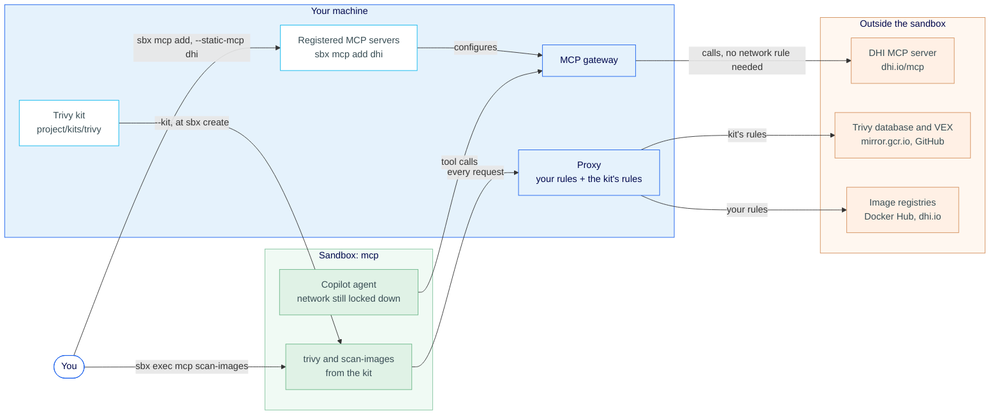

# 🧰 Give your agent tools with MCP

Your agent can only reach the hosts you allowed in the [network policies](01-network-policies.md) module. Sometimes it needs a capability rather than a website: that's what [MCP](https://modelcontextprotocol.io/) (Model Context Protocol) servers provide.

Each sandbox has an **MCP gateway**. The agent only talks to the gateway; the MCP servers you register run **outside** the sandbox, on your host or as remote services. You give the agent new tools without opening its network.

In this module you give your agent the **Docker Hardened Images (DHI)** MCP server, so it can look up a hardened alternative to an image DevBoard uses. Then you scan those images with the **Trivy kit** from the [Kits](02-kits.md#a-kit-with-its-own-image-trivy) module.



1. Register the DHI MCP server, from a terminal on your host:

    ```bash id=host terminal-id=terminal-2
    sbx mcp add dhi --url https://dhi.io/mcp
    ```

    If a browser window opens, sign in with your Docker account to authorize it.

2. Check that it's registered and ready:

    ```bash id=host terminal-id=terminal-2
    sbx mcp ls
    ```

    ```none id=host
    NAME   TRANSPORT     STATUS   GATEWAY                 DETAIL
    dhi    remote http   ready    LOCAL, managed by you
    ```

3. From the `project` directory, create a dedicated sandbox named `mcp`, with the DHI server and the Trivy kit:

    ```bash id=host terminal-id=terminal-2
    sbx create --name mcp --static-mcp dhi --kit ./kits/trivy copilot .
    ```

    `--static-mcp dhi` starts the sandbox's MCP gateway with **exactly this server**, and without the discovery tools an agent could use to find and add servers by itself. You decide which servers it gets. `--kit ./kits/trivy` adds the [Trivy kit](02-kits.md#a-kit-with-its-own-image-trivy) from the Kits module, which you'll use at the end of this module. The first time, `sbx` builds the kit's image, which downloads and checks Trivy (about a minute).

    Check what the gateway was given:

    ```bash id=host terminal-id=terminal-2
    sbx inspect mcp
    ```

    ```none id=host
      MCP gateway:             configured
      MCP mode:                static
      MCP servers:             dhi
    ```

    These lines describe this sandbox's gateway. `sbx mcp ls`, on the other hand, lists the servers registered on your host, whether or not a sandbox uses them.

4. Start an agent in the `mcp` sandbox:

    ```bash id=host terminal-id=terminal-2
    sbx run --name mcp
    ```

    Then give it this prompt:

    ```console id=sandbox terminal-id=terminal-2
    For both the frontend and the backend app, from their Dockerfiles, find the Alpine-based runtime Docker Hardened Image (not a -dev variant) that matches it and how many known CVEs it has. At the end, list the tools you called.
    ```

    The agent reads both Dockerfiles, calls `dhi` tools such as `dhi_get_repository` (Copilot lists them with the gateway's prefix, `mcp-gateway-dhi_get_repository`), and suggests the hardened Python 3.12 Alpine image for the backend and the hardened Node 22 Alpine image for the frontend, each with its CVE count. The prompt asks for Alpine even for the backend, whose `python:3.12-slim` is based on Debian: the Alpine hardened images are smaller and have fewer packages that can carry CVEs. The exact tags it names vary from one run to the next (`3.12-alpine3.22`, for example), and it may drop the registry (`dhi/python:3.12-alpine`): the images you scan below are `dhi.io/python:3.12-alpine` and `dhi.io/node:22-alpine`. If it says that it has no `dhi` tools, see [Troubleshooting](troubleshooting.md).

    > [!NOTE]
    > Most hardened images come in two variants. The **runtime** image is minimal: no shell, no package manager. The **`-dev`** variant adds them (pip, npm, a shell…) for building, and is meant for the build stage of a multi-stage Dockerfile. Because DevBoard's Dockerfiles install packages, an agent left to choose tends to pick the `-dev` variants, which is why the prompt asks for the runtime image. The difference shows in a scan of the Debian-based images: `dhi.io/python:3.12-debian13-dev` had 414 vulnerabilities in our test, against 54 for `dhi.io/python:3.12`.

    > [!NOTE]
    > The CVE counts the agent reports come from the DHI catalog's scan summary (read through the MCP server), so they won't match the Trivy numbers below, which come from scanning the images yourself with Trivy's database and the VEX statements. Two scanners, two data sources, two sets of numbers: compare the hardened image with the original within one source, not across them.

    > [!IMPORTANT]
    > The DHI server also has tools that change things (creating and removing mirrors in your Docker organization). The prompt only asks the agent to look things up, and to list the tools it called: check that list.

5. Exit the session (press **`Ctrl-C` twice**), then look at the sandbox's network activity:

    ```bash id=host terminal-id=terminal-2
    sbx policy log mcp
    ```

    You'll find the Copilot and GitHub hosts, and the gateway itself (`mcp-gateway.docker.internal`, marked `<daemon-managed alias>`), but no request to the DHI server, and you didn't add any network rule: the agent only talks to the gateway, and the gateway reaches the MCP server from outside the sandbox.

> [!WARNING]
> Registering an MCP server is a trust decision. It runs outside the sandbox, with your host's permissions (local servers) or under the remote service's control, so the sandbox's network policy doesn't apply to it. Only register servers you trust.

## Scan the images before and after

Before switching DevBoard's Dockerfiles to the hardened images, measure what you'd gain. The Trivy kit you added to the `mcp` sandbox can scan the current base images and their DHI equivalents.

1. Scan the two current base images and the two hardened images the agent suggested, with the kit's `scan-images` helper. `sbx exec` starts the sandbox again if it's stopped:

    ```bash id=host terminal-id=terminal-2
    sbx exec mcp scan-images python:3.12-slim dhi.io/python:3.12-alpine node:22-alpine dhi.io/node:22-alpine
    ```

    For each image, the helper runs `trivy image --image-src remote --scanners vuln --vex repo`: Trivy reads the image straight from its registry and applies the [VEX](https://docs.docker.com/dhi/explore/security-concepts/vex/) statements, which mark the CVEs that don't affect the image. The first scan also downloads Trivy's vulnerability database, about 130 MB, and the VEX statements, so it takes a minute or two.

    The numbers change as new vulnerabilities are published, so yours will differ by a few. At the time of writing:

    ```none id=host
    python:3.12-slim           92 vulnerabilities (0 critical, 15 high)
    dhi.io/python:3.12-alpine  0 vulnerabilities (0 critical, 0 high)
    node:22-alpine             17 vulnerabilities (0 critical, 7 high)
    dhi.io/node:22-alpine      0 vulnerabilities (0 critical, 0 high)
    ```

    Without the VEX statements, Trivy reports 226, 0, 25 and 0: it counts every published CVE that matches a package version, whether or not it affects the image.

2. See what the scanner reached:

    ```bash id=host terminal-id=terminal-2
    sbx policy log mcp
    ```

    Each host the scanner reached is allowed either by your own rules or by the Trivy kit's rules:

    | Host in the log | What Trivy used it for | Allowed by |
    |-----------------|------------------------|------------|
    | `index.docker.io`, `auth.docker.io`, `production.cloudfront.docker.com` | Reading the Docker Hub images | Your rules, from [Network policies](01-network-policies.md#allow-only-what-the-lab-needs) |
    | `dhi.io` | Reading the hardened images | Your rules |
    | `mirror.gcr.io` | Downloading the vulnerability database | The kit's rules, for this sandbox only |
    | `raw.githubusercontent.com` | Downloading the VEX statements | The kit's rules, for this sandbox only |
    | `github.com`, `api.github.com`, `codeload.github.com` | Downloading the VEX statements | Both: the kit declares them, and your GitHub rules cover them too |

    One request is blocked: `check.trivy.dev`, Trivy's check for a newer version. Neither your rules nor the kit allow it, and the scan doesn't need it.

The scanner read the images, not your machine: it never had your Docker credentials, your `~/.ssh` folder or any host outside its rules. And because Trivy is now in the agent's sandbox, the agent can use it too: next time, you could ask it to scan the images it suggests. Check which variant it picked first: a `-dev` image scores far worse than its runtime image.

[[<< Previous: Port forwarding](09-port-forwarding.md) | [Next >> Wrap up](11-wrap-up.md)]
