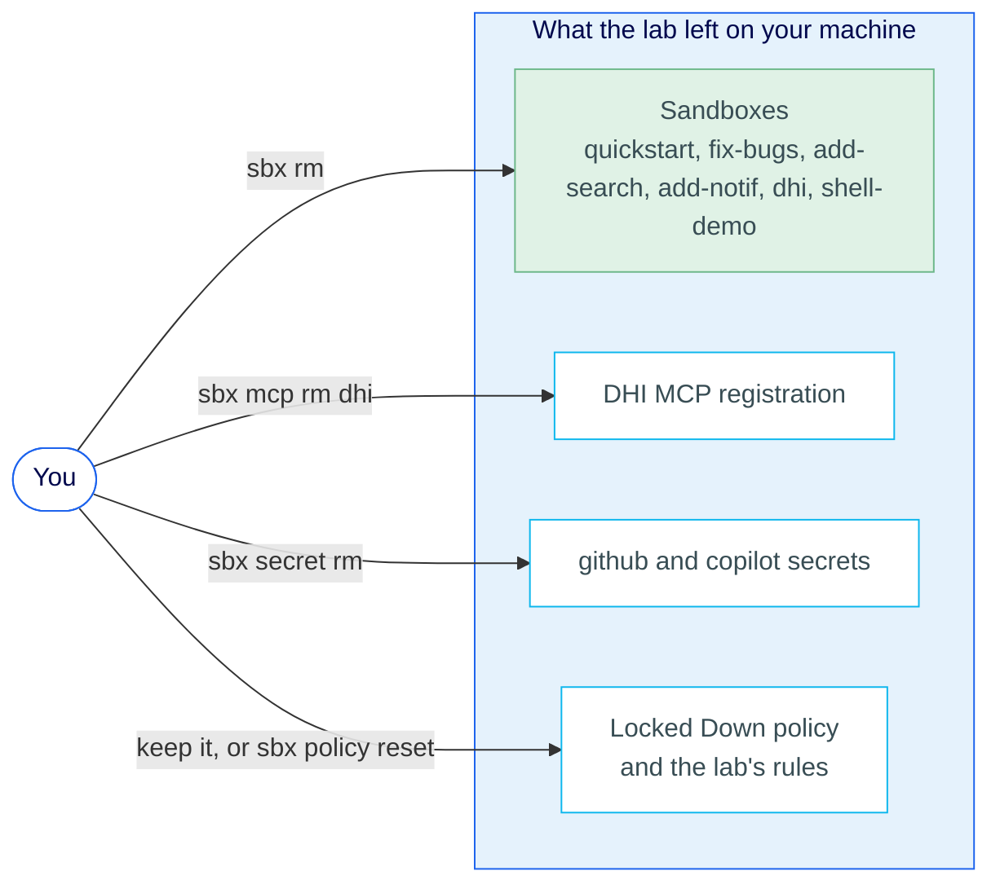

# 🎉 Wrap up

You've completed the **Docker Sandboxes with GitHub Copilot Lab**. Well done!

✅ You now know how to:

- Control which network destinations your agents can reach with **network policies**.
- Read an agent's **kit** to see what it runs and what it's given, and write your own mixin.
- Keep your **credentials** out of the agent's reach while still letting it authenticate.
- Run an agent in **direct mode**, or in isolated **clone mode** with several agents **in parallel**, and review their work before merging it.
- Monitor your sandboxes and their network activity from the **TUI dashboard** and with `sbx policy log`.
- Run **Docker inside a sandbox** and reach the services with **port forwarding**.
- Give your agent tools through the **MCP gateway** without opening its network.

## Clean up



Remove the sandboxes created during the lab, along with everything inside them (images, containers, and data):

```bash id=host terminal-id=terminal-2
sbx ls
sbx rm quickstart fix-bugs add-search add-notif dhi
```

```bash id=host terminal-id=terminal-2
sbx rm shell-demo
```

`sbx rm` asks for confirmation (add `--force` to skip it). `shell-demo` is the sandbox from the network policies module. `sbx prune` removes all stopped sandboxes at once, including ones that aren't from this lab, so use it with care.

> [!NOTE]
> For the three clone-mode sandboxes (`fix-bugs`, `add-search`, `add-notif`), `sbx rm` warns that commits made inside them are lost unless you fetched them first. You did, and you merged them, so you lose nothing. Fetched branches are also kept in your repository under `refs/sandboxes/<name>/*` after removal, and `git branch <local-name> refs/sandboxes/<name>/main` recovers one.

If you don't want to keep the DHI MCP server, remove its registration:

```bash id=host terminal-id=terminal-2
sbx mcp rm dhi
```

Remove the GitHub token you stored in [Secrets and credentials](03-secrets-credentials.md) from your OS keychain (skip this if you use these two secrets for other work):

```bash id=host terminal-id=terminal-2
sbx secret rm github -f
```

```bash id=host terminal-id=terminal-2
sbx secret rm copilot -f
```

Your network policy is still **Locked Down**, with the rules you added for the lab (check with `sbx policy ls`). Keep it, adding hosts as your projects need them, or go back to the **Balanced** profile:

```bash id=host terminal-id=terminal-2
sbx policy reset
```

Then choose **Balanced** in the picker. To do the same without the picker, run `sbx policy reset --force`, then `sbx policy init balanced`.

## Next steps

- [Get Started with Docker Sandboxes learning path](https://docs.docker.com/learn/paths/get-started-with-docker-sandboxes/)
- [Build and customize Docker Sandbox environments learning path](https://docs.docker.com/learn/paths/build-and-customize-docker-sandbox-environments/)
- [Docker Sandboxes documentation](https://docs.docker.com/ai/sandboxes/)
- [Sandboxes versus containers](https://www.docker.com/products/docker-sandboxes/vs-containers/)
- [Docker Sandbox Kit specification](https://github.com/docker/sandbox-kit-spec)

## Feedback

Did you find a problem or have an idea to improve this lab? [Open an issue](https://github.com/mathieu-benoit/sbx-lab/issues). Thank you for joining!

[[<< Previous: MCP servers](10-mcp-servers.md) | [Home](../README.md)]
