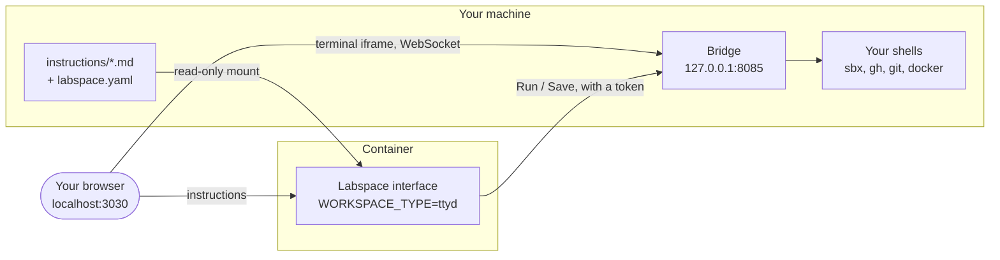

# The lab as a Labspace, with a terminal on your machine

A [Labspace](https://github.com/dockersamples/labspace-infra) rendering of the hands-on lab: the
[instructions](../instructions) on the left, with **Run** buttons, and on the right a terminal that is a real shell
**on your own machine**, not in a container.

A regular Labspace runs its terminal in a VS Code container. That doesn't work for this lab: `sbx` starts microVMs on
your machine, uses your OS keychain and your `gh` login, and the lab compares what you see inside a sandbox with what
your host sees. So the commands must run where `sbx` runs: on your machine.

## Start it

You need the [prerequisites](../instructions/00-prerequisites.md) of the lab and **Docker**: nothing else.

On macOS, Linux, or Windows in Git Bash:

```bash
./labspace-local/start.sh
```

On Windows, from `cmd` or PowerShell (or double-click it):

```powershell
labspace-local\start.cmd
```

It runs [`start.ps1`](start.ps1) with `-ExecutionPolicy Bypass`, for this run only: by default, Windows doesn't run
PowerShell scripts that aren't signed ("running scripts is disabled on this system").

Then open <http://localhost:3030>. The first run downloads the bridge for your system and pulls the interface image.
`Ctrl-C` stops everything. Running `start.sh` again while the Labspace runs is safe: it keeps the running
bridge and its shells, makes sure the interface is up, and opens the browser.

- The shells start in the root of this repository, with your login shell (`$SHELL -l`), or PowerShell on Windows.
- Each tab is a separate shell. Click **+** for another one, as the lab asks for "another terminal".
- A code block with `terminal-id=<name>` (for example `` ```bash terminal-id=agent-2 ``) runs in the tab of that
  name, and creates it if needed.
- Reloading the page keeps the shells and replays their recent output. They stop when you stop `start.sh`.

## How it works



- **Interface**: the published `dockersamples/labspace-interface` image, unchanged. With `WORKSPACE_TYPE=ttyd`, it
  sends the Run and Save buttons to `$WORKSPACE_API_URL/api/command` and `/api/save` instead of the VS Code
  extension, and shows `http://localhost:8085` in its right panel. Only this container is started: no configurator,
  VS Code workspace, socket proxy or port republisher, which a host terminal doesn't need. The Markdown is mounted
  read-only and re-read on every page load, so you can edit the lab and refresh.
- **Content** ([`content.mjs`](content.mjs)): copies `instructions/` to `.content/` as the Labspace shows it, and keeps
  the copy current while the Labspace runs (it checks for changes every second). It runs in two containers of the
  interface image itself (`content-init` and `content` in [`compose.yaml`](compose.yaml)), which has Node.js and the
  `yaml` package, so you don't need Node.js. The static build uses it too.
  - It removes the navigation footer of each module (`[[<< Previous: …] | [Next >> …]]`): the Labspace has its own
    Previous/Next buttons.
  - It keeps the Run and Copy buttons for what you run or type: `bash` blocks are commands (Run and Copy), `console`
    blocks are prompts for the agent (Run and Copy) or, when they start with a table header, outputs (no button), and
    `none`, `yaml` or `dockerfile` blocks are outputs or files to read (no button).
  - It writes `labspace-ui.json`, the sections and milestones for the header and the milestones card.
- **Look of the simulated lab**: [`theme.css`](theme.css) gives the Labspace interface the look of the simulated lab in
  [`../simspace`](../simspace) (fonts, headings, inline code, alerts, code blocks, footer buttons), and
  [`labspace-ui.js`](labspace-ui.js) adds its header ("Labspace", the title, `2 / 13`, a progress track) and a
  **Milestones** card at the top of each section. The milestones are the `steps` of
  [`../instructions/labspace.yaml`](../instructions/labspace.yaml), the same as the simulated lab's: one checks itself
  when you click Run or Copy on a code block, or open a link, whose text contains its `match`, and you can click one to
  check or uncheck it. Progress stays in your browser. `start.sh` adds both files to the image's own `index.html`
  (in `.ui/`, mounted in the container) and serves them from `.content/`; the static build adds them too. The bridge's
  terminal pane takes the look of the simulated lab's terminals.
- **Bridge** ([`bridge/`](bridge)): a small Go server on your machine, one binary with no dependency. It serves the
  terminal page (xterm.js, embedded in the binary), runs one shell per tab in a pseudo-terminal (a pty, or ConPTY on
  Windows), and implements the two endpoints the interface calls. When the program in the terminal accepts bracketed
  paste (zsh at its prompt, Copilot in an agent session), Run pastes the block whole, then presses Enter: a multi-line
  prompt reaches the agent as one message. See [The bridge binary](#the-bridge-binary).
- [`../instructions/labspace.yaml`](../instructions/labspace.yaml) lists the sections.

### Security

The bridge types commands into your shell, so it only accepts what the Labspace sends:

- It listens on `127.0.0.1` only.
- `/api/command` and `/api/save` need a token, which `start.sh` generates once into `labspace-local/.token` (readable
  by you only, never committed) and gives only to the bridge and the interface container. Delete the file to get a new
  token on the next start.
- The WebSocket only accepts the terminal page's own origin (`http://localhost:8085`), and every request must name
  the bridge in its `Host` header, so another web page can't drive the shell, even through DNS rebinding.
- The terminal page can only be framed by `localhost:3030`.
- Save writes only under this repository, or under your home folder for paths that start with `~/`.

## The bridge binary

The bridge binaries are not in the repository: the [`bridge`](../.github/workflows/bridge.yaml) workflow builds them
for macOS, Linux and Windows (amd64 and arm64) and publishes them as a release when a `bridge-v*` tag is pushed, with
their `SHA256SUMS` and a [provenance attestation](https://docs.github.com/actions/security-for-github-actions/using-artifact-attestations).
[`bridge/release.lock`](bridge/release.lock) names the release and the checksum of each binary. The start scripts
download the binary for your system into `.bin/` (ignored by git), and only run it if its checksum matches.

- **To release** a new bridge: push a tag, wait for the release, then write its checksums into `release.lock` and commit
  it:

  ```bash
  git tag bridge-v0.1.0 && git push origin bridge-v0.1.0
  labspace-local/bridge/lock.sh bridge-v0.1.0
  ```

- **Without a release** (`release.lock` names no version), the start scripts build the bridge from source in the
  `golang` image, for your system, so you don't need Go either. The Go caches are kept in the
  `labspace-bridge-go-cache` volume: the first build takes a minute, the next ones a few seconds. To try a change
  with Go installed, build it yourself and point the start script at it:

  ```bash
  cd labspace-local/bridge && go generate ./... && go build -o ../.bin/labspace-bridge .
  LABSPACE_BRIDGE="$PWD/../.bin/labspace-bridge" ../start.sh
  ```

  `go generate` downloads the xterm.js files that the binary embeds, from the npm registry, at pinned versions checked
  against their hash ([`bridge/internal/fetchxterm`](bridge/internal/fetchxterm/main.go)).

- **Signing**: the binaries are not signed. macOS and Windows only check downloads made by a browser (Gatekeeper,
  SmartScreen), and the start scripts download them with `curl` or `Invoke-WebRequest`, which don't mark them as
  downloaded, so they should run without a prompt. Downloaded from the release page with a browser, they are blocked.

## Static preview (GitHub Pages)

[`static/build.mjs`](static/build.mjs) builds the same interface as a static site, to see the rendering without
running anything: no container and no bridge. The right panel is a preview that shows what the **Run** and
**Save** buttons would do. The [`pages`](../.github/workflows/pages.yaml) workflow publishes it to GitHub Pages in
`labspace/` (`https://<owner>.github.io/sbx-lab/labspace/`), next to the simulated lab in `simspace/` and the hands-on lab at the root.

```bash
node labspace-local/static/build.mjs --base /sbx-lab/labspace/ --out _site/labspace
```

It builds the interface client from `dockersamples/labspace-infra` at a pinned commit, with small patches (base path,
preview panel instead of VS Code), writes the sections as JSON files, and adds a script that answers the client's
`/api` calls from them.

## Known limitations

- **No IDE**: "open file" links do nothing. Use your own editor on the repository.
- **Windows**: the bridge is built and tested on Windows in CI, but `start.ps1` and `start.sh` in Git Bash have not
  been tried on Windows yet.
- The interface image is used as `latest`; its `ttyd` workspace mode is recent (April 2026). It also reads a VS Code
  signing key at start-up even in that mode, which is why [`unused-signing.key`](unused-signing.key) is mounted.
- Ports 3030 and 8085 are fixed: the interface always shows `http://localhost:8085` in its right panel.
