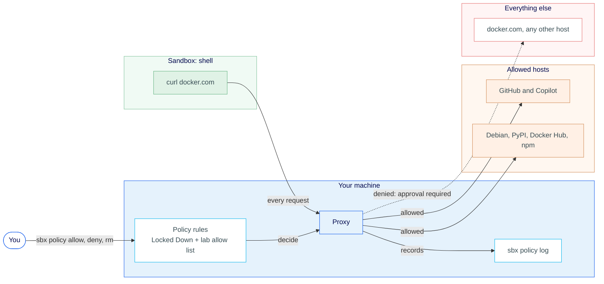

# Network policies

Every sandbox routes outbound HTTP/HTTPS through a host-side proxy that enforces access rules you define. There are three built-in postures:

| Policy      | Description                                                                          |
|-------------|--------------------------------------------------------------------------------------|
| Open        | All traffic allowed, no restrictions                                                 |
| Balanced    | Default deny, with a broad allow-list covering AI APIs, npm, pip, GitHub, registries |
| Locked Down | Everything blocked; you explicitly allow what you need                               |

In this lab you will use **Locked Down**, and allow only the hosts the exercises need.



## Test the Locked Down profile

> **Warning:** `sbx policy reset` **deletes every network rule you have created on this machine**, not only the lab's. If you use `sbx` for other work, save your current rules first with `sbx policy ls` and re-add them afterwards.

Reset the policies, then choose the default without the interactive picker:

```bash id=host
sbx policy reset --force
```

```bash id=host
sbx policy init deny-all
```

> **Tip:** plain `sbx policy reset` shows a picker instead. In this simulation it selects **Locked Down** for you.

Check the configured policies. You now see only `default-deny-all` and a `local-policy` with no network rule:

```bash id=host
sbx policy ls
```

Check whether `docker.com` is reachable under this policy:

```bash id=host
sbx policy check network docker.com
```

It's `Denied`: *no matching allow rule (default deny)*.

Now start your **first sandbox**: a microVM with just a shell, no agent yet. The current folder is its workspace, and `--name` gives it a name you will reuse when you clean up:

```bash id=host
sbx run shell --name shell-demo
```

Your prompt changes: you're now inside the sandbox. Try to reach `docker.com` from there:

```prompt id=sandbox
curl docker.com
```

The request never left your machine: the host-side proxy blocked it and filed a **pending approval**. You could grant it from the host with `sbx policy approval`, or from the TUI dashboard. The difference: **approving** answers this one request, while **allowing** (`sbx policy allow network`) adds a rule that applies to every sandbox from then on.

Leave this sandbox to return to your host:

```prompt id=sandbox
/exit
```

## See what the sandbox is hitting

To view the hosts that were allowed or blocked by the proxy, use `sbx policy log`:

```bash id=host
sbx policy log
```

Add `--json` for a machine-readable output.

## Allow additional hosts

Use `sbx policy allow network` to allow communication with `docker.com`:

```bash id=host
sbx policy allow network docker.com
```

Check it again; it's now `Allowed`:

```bash id=host
sbx policy check network docker.com
```

Reconnect to the sandbox and try again, showing only the response headers:

```bash id=host
sbx run --name shell-demo
```

```prompt id=sandbox
curl -I docker.com
```

This time `docker.com` answers itself, with a `301 Moved Permanently` redirect to HTTPS, instead of the proxy's approval message.

```prompt id=sandbox
/exit
```

> **Tip:** you can allow several hosts in a single command, and use wildcards: `*.example.com` matches exactly one subdomain level (`api.example.com`), `**.example.com` matches any depth (`api.eu.example.com`). Neither matches `example.com` itself.
>
> ```bash id=host no-run-button
> sbx policy allow network "smtp.mailgun.org,api.sendgrid.com"
> sbx policy allow network "**.npmjs.org"
> ```

## Block a host, then clean up

To explicitly block a host, use `sbx policy deny`:

```bash id=host
sbx policy deny network ads.example.com
```

Each rule you define manually is stored separately. Remove them with `sbx policy rm` (the real command asks you to confirm; add `--force` to skip the question):

```bash id=host
sbx policy rm network --resource docker.com
```

```bash id=host
sbx policy rm network --resource ads.example.com
```

## Reaching host services from inside the sandbox

If a service runs on your host (a local Ollama, a database), `localhost` inside the sandbox is the sandbox itself. Use the name `host.docker.internal`, which the proxy routes to your host. The policy rule names the service as your host sees it, `localhost:<port>`, so you decide which ports of your own machine are reachable, one by one. You don't need this for the lab:

```bash id=host no-run-button
sbx policy allow network localhost:11434
```

Then point the client in the sandbox at `host.docker.internal:11434`.

## Allow only what the lab needs

You keep the **Locked Down** policy for the rest of the lab: rather than trusting a broad allow list, you allow exactly the hosts your agents need, and nothing else. Add these four rules.

GitHub and GitHub Copilot, the agent itself:

```bash id=host
sbx policy allow network "github.com:443,**.github.com:443,**.githubcopilot.com:443"
```

Python for the backend tests, Debian packages and PyPI:

```bash id=host
sbx policy allow network "deb.debian.org:80,dhi.io:80,dhi.io:443,pypi.org:443,files.pythonhosted.org:443"
```

Docker Hub, to pull images:

```bash id=host
sbx policy allow network "**.docker.io:443,production.cloudfront.docker.com:443"
```

Node.js, for the frontend's npm packages:

```bash id=host
sbx policy allow network "registry.npmjs.org:443"
```

| Rule | Used by |
|------|---------|
| `github.com:443`, `**.github.com:443` | GitHub API, used by Copilot; also where Trivy downloads the VEX statements |
| `**.githubcopilot.com:443` | Copilot service; the subdomain depends on your plan (`api.individual…`, `api.business…`, `api.enterprise…`), hence `**` |
| `deb.debian.org:80`, `dhi.io:80`, `dhi.io:443` | The sandbox image's `apt` repositories, used to install Python. `dhi.io` is also the Docker Hardened Images registry, which Trivy reads later |
| `pypi.org:443`, `files.pythonhosted.org:443` | Installing the backend's Python packages |
| `**.docker.io:443`, `production.cloudfront.docker.com:443` | Pulling the `python`, `node` and `postgres` images, and the images Trivy scans |
| `registry.npmjs.org:443` | Installing the frontend's npm packages |

A few more hosts are needed later, but you don't add them here: the kits that need them declare them, and those rules apply only to the sandboxes that use the kit. Each rule ends with a **port**, so it allows that host on that port only. Everything is HTTPS (port 443), except the `apt` repositories: the sandbox image reads `deb.debian.org` and `dhi.io` over plain HTTP (port 80), so a `:443` rule alone would break `apt-get update`. `dhi.io` gets both ports, `:80` for its packages and `:443` for its image registry. A rule without a port would allow the host on any port.

List the policies again: `local-policy` now has one network rule per host and port (11 in total).

```bash id=host
sbx policy ls
```

Check a few of them. The first two are `Allowed`, both by a wildcard rule: `api.github.com` by `**.github.com:443` and the Copilot host by `**.githubcopilot.com:443` (each `Rule` line shows a different ID). A host without a port is checked on port 443. `docker.com` is still `Denied`, because you removed its rule above:

```bash id=host
sbx policy check network api.github.com
```

```bash id=host
sbx policy check network api.individual.githubcopilot.com
```

```bash id=host
sbx policy check network docker.com
```

> **Tip:** if an agent later fails to download something, run `sbx policy log` to see the blocked host, then allow it with `sbx policy allow network <host>`.
