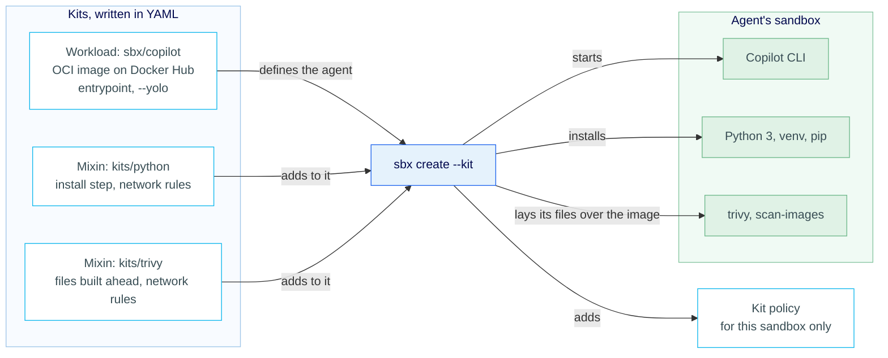

# Kits

Every agent you run in this lab comes from a **kit**. A kit is a declarative YAML artifact, published to a registry like an image, that describes an agent's sandbox: which image runs, how the agent starts, and what it is given (credentials, network policies, environment variables, startup commands and files).

Because all of that lives in one versioned artifact, the agent's environment, and the authority it gets, is reproducible and reviewable: a change in what an agent is allowed to do shows up as a change in its kit.

Kits use the **v3** format: a YAML descriptor that starts with `# syntax=docker/sandbox-kit:3` and `schemaVersion: "3"`, often next to a Dockerfile. There are two kinds of kits:

| Kind | What it does | Example |
|------|--------------|---------|
| Workload (`kind: workload`) | Defines what runs, here the agent: its image, entrypoint, default arguments, and what it needs | `sbx/shell`, `sbx/copilot`, `sbx/claude`, OCI images on Docker Hub |
| Mixin (`kind: mixin`) | Extends a workload with a tool, a credential, a network rule, a file… | `sbx/scout-cli`, or your own; added with `sbx create <agent> --kit <reference>` |



## Inspect the Copilot kit

Show a summary of the kit that `sbx run copilot` uses:

```bash id=host
sbx kit inspect sbx/copilot
```

Then the kit's declaration itself:

```bash id=host
sbx kit inspect sbx/copilot --format yaml
```

> **Note:** `sbx kit inspect` shows a kit as `sbx` reads it, not its source file. `sbx` v0.54 prints a workload as `Kind: sandbox`, with a `sandbox:` block for its image, entrypoint and command. In a v3 kit's source, these come from the Dockerfile next to the `kind: workload` descriptor: `FROM` sets the image, and `ENTRYPOINT` and `CMD` set the entrypoint and the default command.

It's a small file, and it tells you a lot about the sandboxes you'll use in this lab:

| In the kit | What it means | Where you'll see it |
|------------|---------------|---------------------|
| `sandbox.image`, pinned by digest, built from Docker Hardened Images | The sandbox's image: a minimal Debian image with the `agent` user and Docker, but no Python | *Agent sandbox*: you add Python with the kit below |
| `entrypoint: copilot` | `sbx run` starts the Copilot CLI | *Agent sandbox* |
| `command.default: --yolo` | Copilot runs without asking for confirmations; arguments you pass after `--` are added to it | *Agent sandbox*, *Clone mode and parallel agents* |
| `args`: `model` and `reasoningEffort`, empty by default | Settings you can choose when you create a sandbox, with `--kit-arg` | *Choose the model and the reasoning effort*, below |
| `environment`: `COPILOT_KIT_MODEL`, `COPILOT_KIT_REASONING_EFFORT` | Two variables set inside the sandbox, which carry the arguments' values | *Choose the model and the reasoning effort*, below |
| No network rules (`Policies` lists only the environment variables) | The descriptor declares no network rules. `sbx` still allows Copilot's own core hosts for each Copilot sandbox, on top of the rules you added | *Agent sandbox*, with `sbx policy ls` |

## Choose the model and the reasoning effort

The kit's `args` are settings of the kit itself, which you choose when you create a sandbox, with `--kit-arg <name>=<value>` (see the `sbx/copilot` page on Docker Hub):

- `model`: the Copilot model, such as `claude-sonnet-5.5` or `gpt-5.6-sol`. It must be available on your Copilot plan.
- `reasoningEffort`: how much the model reasons before it answers: `none`, `minimal`, `low`, `medium`, `high`, `xhigh` or `max`, if the model supports that level.

Both are empty by default, which keeps Copilot's own defaults, and this lab keeps them. When the sandbox is created, the kit sets the two `environment` variables to the values you chose and writes them into Copilot's settings, `~/.copilot/settings.json` (`model` and `effortLevel`). With several kits, as in *Agent sandbox*, prefix each name with the kit's, `copilot.`:

```bash no-run-button
sbx create --name tuned --kit ./kits/python --kit-arg copilot.model=claude-sonnet-5.5 --kit-arg copilot.reasoningEffort=high copilot .
```

Copilot then starts with this model and this effort in every session of the sandbox, and `/model` still changes them during a session. Kit arguments configure the kit, not the agent's command line: what you pass after `--`, as in *Clone mode and parallel agents*, goes to Copilot itself and is added to `--yolo`.

## The built-in agent kits are OCI images

The agent kits that come with Docker Sandboxes are published on Docker Hub, in the `sbx` namespace, as regular **OCI images**: the same format as any container image, multi-platform (`linux/amd64` and `linux/arm64`), and built from Docker Hardened Images.

| Kit | Agent | Docker Hub |
|-----|-------|------------|
| `sbx/shell` | A plain shell, no agent | [hub.docker.com/r/sbx/shell](https://hub.docker.com/r/sbx/shell) |
| `sbx/copilot` | GitHub Copilot CLI | [hub.docker.com/r/sbx/copilot](https://hub.docker.com/r/sbx/copilot) |
| `sbx/claude` | Claude Code | [hub.docker.com/r/sbx/claude](https://hub.docker.com/r/sbx/claude) |

Docker publishes mixins the same way. [`sbx/scout-cli`](https://hub.docker.com/r/sbx/scout-cli) is one: also a multi-platform OCI image on Docker Hub, which adds the Docker Scout CLI to an agent's sandbox. You'll add it with `--kit sbx/scout-cli` in *MCP servers*, to compare images with Docker Scout.

So the `image` you saw in the kit, `docker.io/sbx/copilot@sha256:906cde56...`, is the image on [hub.docker.com/r/sbx/copilot](https://hub.docker.com/r/sbx/copilot), pinned by the digest of its image index. Kits are distributed, versioned, pinned and cached like images, through the same registries, which is also how you can share your own kits, with `sbx kit push` (see *Build your own kit*).

If you have the Docker CLI on your host, you can see it for yourself (optional):

```bash id=host
docker buildx imagetools inspect sbx/copilot:latest
```

The digest of the `latest` tag is the one pinned in the kit, and the index holds one image per platform.

## Compare with another agent kit

Kits describe every agent the same way. Inspect the Claude Code kit:

```bash id=host
sbx kit inspect sbx/claude
```

It's described the same way, with one more part of the format:

- The same **arguments**, `model` and `reasoningEffort`, with Claude's own values: its `reasoningEffort` also accepts `auto`, for example. You set them with `--kit-arg` too.
- The same two **environment variables** (`Policies: Environment: 2 variables`), which carry them.
- An **AI file** (`/home/agent/.claude/CLAUDE.md`), where context for the agent is placed.

## Build your own kit

Writing a kit is mostly writing YAML. The DevBoard project includes a small mixin that adds Python to an agent's sandbox, so your agent doesn't have to install it by hand. Read it:

:filelink[project/kits/python/python.yaml]{path="project/kits/python/python.yaml"}

It declares two capabilities: a **lifecycle** hook that runs once when the sandbox is created, and a **network policy** that opens only the hosts this kit needs. For the install, that's the sandbox image's apt repositories, `deb.debian.org` and `dhi.io`, because `apt-get update` reads every configured source. At runtime, it's PyPI for `pip`. No Dockerfile is needed for this one.

> **Note:** the `install` and `runtime` lists say when each host is needed. Once the sandbox runs, its kit policy lists only the `runtime` hosts. In a Copilot sandbox it also lists `deb.debian.org:80` and `dhi.io:80`, which come from the Copilot agent. The global rules from module 01 allow both hosts anyway.

Check that the kit is valid:

```bash id=host
sbx kit validate ./project/kits/python
```

See what it declares:

```bash id=host
sbx kit inspect ./project/kits/python
```

You'll use this kit to create the sandboxes your agents work in.

To share a kit, publish it in a Git repository or an OCI registry (`sbx kit push`). Remote kits are only installed from trusted publishers: `sbx` checks each reference against the `kit.allowedSources` setting.

## A kit with its own image: Trivy

The Python kit installs its tool when the sandbox is created, so its network policy must open the Debian hosts during that install. A kit can also bring a Dockerfile and install its tools **when the kit itself is built**, on your machine, before any sandbox exists. The project includes a second mixin made that way, adapted from Docker's [trivy-mixin kit](https://github.com/docker/sbx-kits-contrib/tree/v3/trivy-mixin). It adds [Trivy](https://trivy.dev/), Aqua's open source vulnerability scanner, to an agent's sandbox:

:filelink[project/kits/trivy/trivy.yaml]{path="project/kits/trivy/trivy.yaml"}

The first three hosts serve Trivy's vulnerability database. The GitHub hosts serve VEX statements, which mark the CVEs that don't affect an image, including those published for Docker Hardened Images. Next to it, `trivy.dockerfile` builds the kit's image in two stages: the first downloads Trivy 0.70.0 and checks the download against the SHA256 published for each architecture; the second starts from an empty image (`scratch`) and keeps only the files the mixin adds. When you add the mixin to an agent, `sbx` lays these files over the agent's image.

| | Python kit | Trivy kit |
|---|---|---|
| Installs its tool | When the sandbox is created (`lifecycle` hook running `apt-get`) | When the kit is built (`trivy.dockerfile`), pinned by version and SHA256 |
| Adds to the sandbox | Packages, installed inside each new sandbox | A layer of files, laid over the agent's image |
| Network policy | Debian hosts for the install, PyPI at runtime | Trivy's vulnerability database and the VEX statements, at runtime only |

Why put a scanner in a sandbox? It reads all your code, and it's a supply-chain target like any other tool: Trivy's own releases were compromised in March 2026. In a sandbox, it sees the workspace but not your `~/.ssh` or `~/.docker/config.json`, and it can reach its database, the VEX statements and the hosts you allowed, nothing else. You add this kit to an agent's sandbox in the *MCP servers* module.

## Two more ways to package it

You don't need to run these, and the rest of the lab doesn't use them. They're here so you know they exist; the [full lab](https://github.com/mathieu-benoit/sbx-lab/blob/main/instructions/02-kits.md) shows both in detail.

- **A kit set** (Early Access) packages a combination of kits, such as Copilot + Python + Trivy, as a single kit, so your team runs one reference. A sandbox created from a set is the same as one created from its kits, and downloads the same layers; the difference is that the set is checked, assembled and pinned by digest once, when it's published, instead of each time a sandbox is created. It's about one reference you can trust, not speed.
- **An environment file** (`sbxenv.yaml`, experimental) describes a whole sandbox: the agent and its kits, the workspace, the secrets, the published ports, MCP servers. Commit it with the project and every contributor gets the same sandbox. This very repository uses one: `sbx env run` starts the sandbox for authoring these simulated labs.
