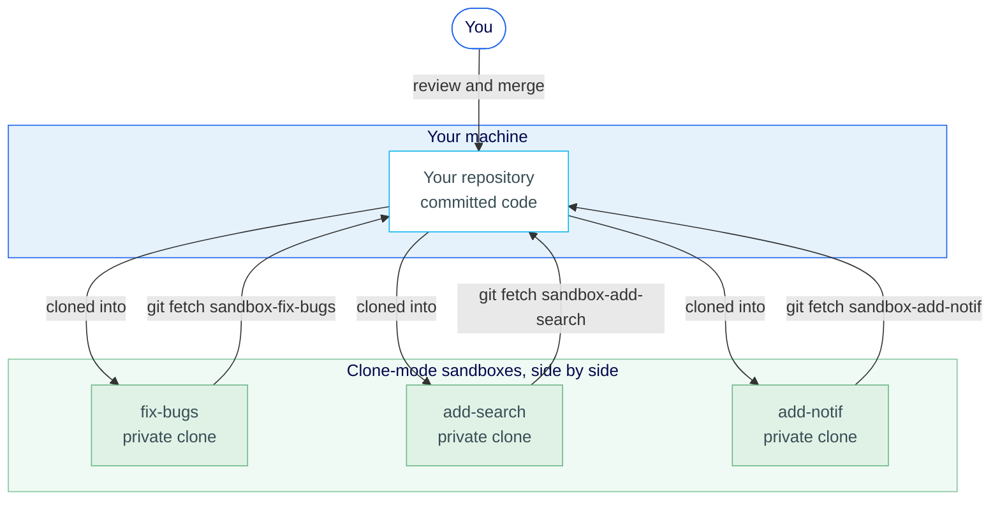

# Clone mode and parallel agents

## Direct mode vs. clone mode

Everything in the previous module ran in **direct mode**: your agent edited your working tree and you saw the changes immediately. That is great for interactive work.

**Clone mode** gives your agent a private Git clone inside the sandbox, isolated from your working tree. You keep working normally while the agent works in its own clone. Afterwards you fetch its commits and review the diff before anything lands. Use it when you want a clean diff to review, or when you run several agents at the same time.



| | Direct mode (`quickstart`) | Clone mode (`--clone`) |
|---|---|---|
| Where the agent edits | Your working tree, live | A private Git clone inside the sandbox |
| Starts from | Your files, committed or not | Your **committed** code |
| Run it from | The folder to share (`project/`) | The root of the Git repository |
| You see its work | Instantly, in your editor | After `git fetch sandbox-<name>` |
| Good for | Interactive, one agent | Reviewable diffs, several agents at once |

> **Note:** the clone starts from your **committed** code. Make sure the fix from the previous module is committed.

This module uses several terminals on your host, all opened at the root of the repository. They are the tabs on the right:

| Terminal | Single clone | Parallel agents |
|----------|--------------|-----------------|
| 1 | `fix-bugs` agent | `add-search` agent |
| 2 | `git fetch` and `git merge` | `git fetch` and `git merge`, then the `quickstart` agent |
| 3 | | `add-notif` agent |
| 4 | | TUI dashboard |

## Single clone: working in isolation

1. In **Terminal 1**, go back to the **root of the repository**. Clone mode must be started from there: from the `project` folder, `sbx` stops with the error `--clone requires a Git repository`. The agent therefore sees the whole repository, with the application in the `project/` folder.

    ```bash id=host
    cd ..
    ```

2. Start a new agent in clone mode with the `--clone` flag. Give it a name: it also names the Git remote that you will fetch from later. As for `quickstart`, add the DevBoard kit (from the root of the repository, its path is `./project/kits/devboard`):

    ```bash id=host
    sbx run copilot --clone --name fix-bugs --kit ./project/kits/devboard
    ```

    The agent works inside a private Git clone, and your own working tree is only available to it read-only.

3. Give your agent the following prompt to fix the last failing test:

    ```prompt id=sandbox
    One test is still failing: test_updated_at_changes_on_update. The updated_at columns in project/backend/app/models.py are never refreshed when a row is updated. Fix the bug, run the tests to confirm it, and commit with a descriptive message.
    ```

4. Once the agent has finished, switch to **Terminal 2**, leaving the agent session open in Terminal 1, and fetch its work:

    ```bash id=host terminal-id=t2
    git fetch sandbox-fix-bugs
    ```

    ```bash id=host terminal-id=t2
    git log HEAD..sandbox-fix-bugs/main --oneline
    ```

    The sandbox exposes its clone as a Git remote named `sandbox-<name>`, and its branches are named `sandbox-<name>/<branch>`, where `<branch>` is the branch that was checked out when the sandbox was created (typically `main`). Review the commits, then merge or cherry-pick them as you normally would:

    ```bash id=host terminal-id=t2
    git merge --no-edit sandbox-fix-bugs/main
    ```

    > **Note:** Git reaches the sandbox's clone through `sbx` itself, so the fetch only works while the sandbox is running. When the sandbox stops, `sbx` removes the `sandbox-fix-bugs` remote, and `git fetch` fails with `'sandbox-fix-bugs' does not appear to be a git repository`. Restart the sandbox with `sbx run --detach --name fix-bugs`: the remote comes back, and the fetch works again.

    Once merged, exit the `fix-bugs` session in Terminal 1:

    ```prompt id=sandbox terminal-id=t1
    /exit
    ```

## Parallel agents

Because each clone-mode sandbox has its own private Git clone, you can run several agents at the same time without conflicts. The key is to give each sandbox a distinct `--name` and to hand each agent its task up front through a prompt file, so that both can start without any back-and-forth.

DevBoard has two unfinished features that make ideal parallel tasks:

- **Search**: `GET /projects/{id}/issues/search?q=` returns `501`; the query logic needs to be written.
- **Notifications**: `send_status_change_notification()` only logs; it should send emails when an issue's status changes.

The `project/prompts/` directory contains a ready-made prompt file for each:

:filelink[project/prompts/implement-search.txt]{path="project/prompts/implement-search.txt"}
:filelink[project/prompts/implement-notifications.txt]{path="project/prompts/implement-notifications.txt"}

1. In **Terminal 1**, start an agent that implements search. The `"$(cat ...)"` must be quoted, otherwise the prompt is not passed correctly to the agent:

    ```bash id=host terminal-id=t1
    sbx run copilot --clone --name add-search --kit ./project/kits/devboard -- -i "$(cat project/prompts/implement-search.txt)"
    ```

2. In **Terminal 3**, start a second agent that implements notifications:

    ```bash id=host terminal-id=t3
    sbx run copilot --clone --name add-notif --kit ./project/kits/devboard -- -i "$(cat project/prompts/implement-notifications.txt)"
    ```

    Each sandbox gets its own isolated Git clone, so the agents read and write completely separate copies of the code. Copilot already runs with `--yolo` by default, so the agents don't wait for confirmation.

3. While they work, open the dashboard in **Terminal 4**:

    ```bash id=host terminal-id=t4
    sbx
    ```

    Each agent has its own card, with its own CPU and memory use: two microVMs side by side. In the live dashboard, press `Tab` for the Network panel and watch both agents reach the Copilot service and PyPI as they set up Python and run the tests, each under its own sandbox name.

When both agents report that they are done, fetch their work from **Terminal 2**:

```bash id=host terminal-id=t2
git fetch sandbox-add-search
```

```bash id=host terminal-id=t2
git fetch sandbox-add-notif
```

## Reviewing and merging agent work

After fetching, each agent's commits are available as remote-tracking branches, the same model as working with `origin`.

1. Inspect what each agent committed before merging anything:

    ```bash id=host terminal-id=t2
    git log HEAD..sandbox-add-search/main --oneline
    ```

    ```bash id=host terminal-id=t2
    git diff HEAD...sandbox-add-search/main --stat
    ```

    And the same for the notifications task:

    ```bash id=host terminal-id=t2
    git log HEAD..sandbox-add-notif/main --oneline
    ```

    ```bash id=host terminal-id=t2
    git diff HEAD...sandbox-add-notif/main --stat
    ```

2. Merge each agent's branch into your working branch. `--no-edit` keeps Git's default merge message instead of opening an editor. If both agents changed the same files you may get a merge conflict: resolve it as you would any other conflict, then run `git merge --continue`.

    ```bash id=host terminal-id=t2
    git merge --no-edit sandbox-add-search/main
    ```

    ```bash id=host terminal-id=t2
    git merge --no-edit sandbox-add-notif/main
    ```

3. Check that the merged result works. In Terminal 2, reconnect to your `quickstart` sandbox, whose workspace is your working tree:

    ```bash id=host terminal-id=t2
    sbx run --name quickstart
    ```

    Then give the agent this prompt:

    ```prompt id=sandbox terminal-id=t2
    Run the full test suite and report the results.
    ```

    All the tests should now pass, including the search test and the new notification tests. Exit the session:

    ```prompt id=sandbox terminal-id=t2
    /exit
    ```

4. Finally, leave the two agent sessions that are still open in Terminals 1 and 3:

    ```prompt id=sandbox terminal-id=t1
    /exit
    ```

    ```prompt id=sandbox terminal-id=t3
    /exit
    ```
