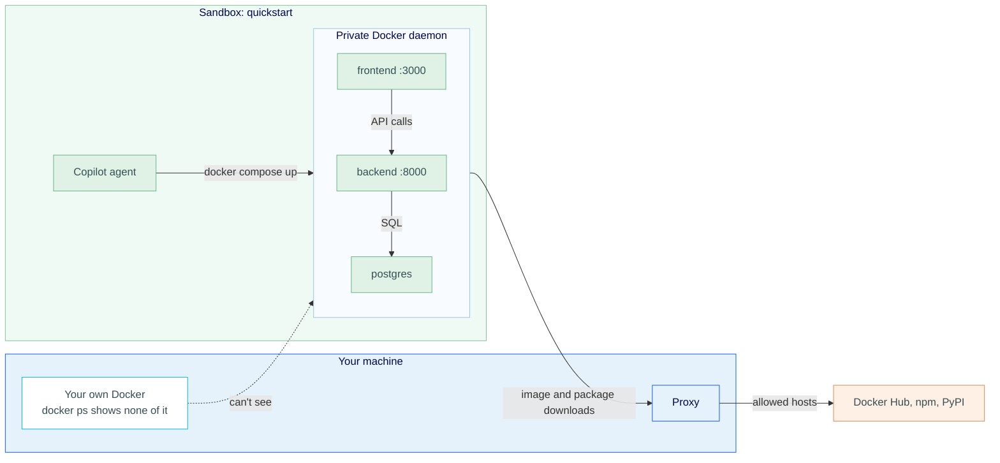

# Docker inside the sandbox

Each sandbox has its own private Docker daemon. Your agent can run `docker compose up`, build images, and start containers, and none of them appear in your host's `docker ps`.



1. In **Terminal 1**, go back to the `project` directory (the previous module left you at the root of the repository) and reconnect to your sandbox:

    ```bash id=host
    cd project
    ```

    ```bash id=host
    sbx run --name quickstart
    ```

2. Give your agent the following prompt:

    ```prompt id=sandbox
    Start the full application stack using Docker Compose.
    Once everything is healthy:
    1. Confirm the backend API is responding at http://localhost:8000/health
    2. Create a test user via the API
    3. Create a project and two issues for that user
    4. Report the final state (user, project, issues) as JSON

    Use the API docs at http://localhost:8000/docs if helpful.
    Make sure all servers bind to 0.0.0.0 so I can reach them via port forwarding.
    ```

    You see your agent run `docker compose up --build -d`, wait for the database and backend health checks to pass, then call the API endpoints. The first run pulls images and installs the frontend dependencies, so in the real lab it can take a few minutes.

3. From inside the agent session, list the running containers:

    ```prompt id=sandbox
    !docker ps
    ```

    Three containers run inside the sandbox: the frontend, the backend and PostgreSQL. Now run `docker ps` in **Terminal 2**, on your host:

    ```bash id=host terminal-id=t2
    docker ps
    ```

    The list is empty: your host's Docker can't see the sandbox's containers.

4. **Leave the agent session open** and move on to the next module.

    > **Important:** a sandbox stops when no agent session is attached to it, and its containers and published ports go with it. If you exit the session, restart the sandbox without opening a new session with `sbx run --detach --name quickstart`. The Compose services restart on their own within a few seconds, and published ports are restored.

The containers your agent runs live entirely inside the sandbox. When you remove the sandbox with `sbx rm`, all its images, containers, and PostgreSQL data are deleted too.
