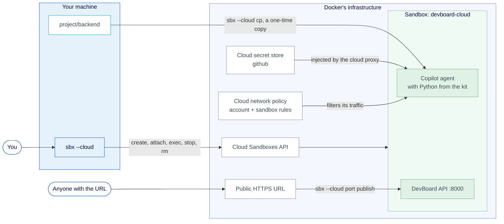

# Cloud sandboxes

Every sandbox so far ran on your machine. Add `--cloud` to the same `sbx` commands and the sandbox runs on **Docker's infrastructure** instead: a microVM with the same isolation, the same kits and the same agent, but no path back to your machine. Your agent keeps working when you close your laptop, and you can share what it serves through a public HTTPS URL.

> **Important:** in the real lab this module is **optional**. Cloud sandboxes need a Docker Agentic Platform subscription, and their compute is billed **pay as you go** while they run (a stopped sandbox isn't billed). It uses one small sandbox (2 CPUs, 4 GiB) for under an hour, plus about 10 AI Credits. Here it's simulated, and free.



What changes from a local sandbox:

| | Local sandbox | Cloud sandbox |
|---|---|---|
| Runs on | Your machine | Docker's infrastructure, billed while running |
| Workspace | Your folder, mounted (or a private clone) | None: copy files in with `sbx --cloud cp`, or `git clone` inside |
| Secrets | `sbx secret` | A separate store: `sbx --cloud secret` |
| Network policy | Your local policy | A separate, network-only policy: account and sandbox rules |
| Ports | `localhost:<port>` on your machine | A public HTTPS URL |
| Lifetime | Until you remove it | A time-to-live (1 hour by default), then stopped or deleted |

Kits, `--kit-arg`, `sbx exec` and the agents themselves work the same way. Use **Terminal 2**, in the `project` directory.

## Same CLI, separate sandboxes

1. Check that your account can use cloud sandboxes:

    ```bash id=host terminal-id=t2
    sbx --cloud diagnose
    ```

2. List your cloud sandboxes. `sbx ls` still lists `quickstart` and the others, but `--cloud` switches the whole command to the cloud backend, with its own sandboxes, secrets, network policy and templates:

    ```bash id=host terminal-id=t2
    sbx --cloud ls
    ```

## Give the cloud a credential

Your local secrets stay in your OS keychain: the cloud can't use them. Store your GitHub token in the cloud secret store. The cloud proxy adds it to the agent's requests, as your local proxy did. In the real lab, paste the output of `gh auth token` when prompted:

```bash id=host terminal-id=t2
sbx --cloud secret set github
```

```bash id=host terminal-id=t2
sbx --cloud secret ls
```

That one secret is enough for Copilot: in the cloud, it covers both `GH_TOKEN` and `COPILOT_GITHUB_TOKEN`. `--command 'gh auth token'` isn't supported in the cloud, which stores the value itself.

## Network policy in the cloud

The cloud has its own policy: the Locked Down policy and the rules from the *Network policies* module stay on your machine. It has two scopes: your **account**, whose default your cloud sandboxes start from, and each **sandbox**.

1. Look at your account's policy. In the real lab, yours may show another default, or rules, if you or your organization set them:

    ```bash id=host terminal-id=t2
    sbx --cloud policy ls
    ```

2. Set the account's default to `deny-all`, the cloud's equivalent of the Locked Down policy. The presets are `allow-all`, `balanced` (deny-all plus an allow list of common development services) and `deny-all`. `init` keeps the existing allow and deny rules, and you can run it again to change the default; `sbx --cloud policy reset` removes the account's rules and goes back to the platform's default:

    ```bash id=host terminal-id=t2
    sbx --cloud policy init deny-all
    ```

    > **Warning:** this changes the default for **all** the cloud sandboxes of your Docker account, not only this lab's. Add `--sandbox <name>` to set the default of one sandbox only.

3. Your sandbox's own policy adds to this default: the rules its **kits** declare, and the ones you add for it, with `--allow-network` or `--deny-network` on `sbx --cloud create`, or later with `--sandbox <name>`. You'll check them once the sandbox exists.

## Create a cloud sandbox

1. Create the sandbox with the same Copilot agent and Python kit as `quickstart`:

    ```bash id=host terminal-id=t2
    sbx --cloud create --name devboard-cloud --kit ./kits/python --ttl 1h --on-timeout stop copilot
    ```

    - There's **no `.`** at the end: a cloud sandbox has no workspace to mount, and passing a path is an error.
    - `--ttl 1h --on-timeout stop`: the sandbox stops after an hour unless you extend it.
    - No `--cpus` or `--memory`: the default is 2 CPUs and 4 GiB, the `small` size. Sizes go from `micro` (1 CPU, 2 GiB) to `xl` (16 CPUs, 32 GiB).

    In the real lab, the first time takes about 3 minutes: `sbx` builds the kit's image and uploads it as a cloud template.

2. Look at it, then check what's inside, as you did for `quickstart`:

    ```bash id=host terminal-id=t2
    sbx --cloud inspect devboard-cloud
    ```

    ```bash id=host terminal-id=t2
    sbx --cloud exec devboard-cloud sh -c 'python3 -V; env | grep TOKEN; ls ~/workspace'
    ```

    Python came with the kit, the tokens are placeholders, and the workspace is **empty**: nothing from your machine is there.

### Check its network rules

3. List the sandbox's rules. You didn't add any of them: the Copilot agent declares the hosts it needs, and the Python kit adds Debian and PyPI. A `deny-all` default still lets through what a sandbox's own rules allow, including its kits' rules, and blocks everything else:

    ```bash id=host terminal-id=t2
    sbx --cloud policy ls devboard-cloud
    ```

4. Try a host that isn't on the list:

    ```bash id=host terminal-id=t2
    sbx --cloud exec devboard-cloud curl -sS -o /dev/null https://docker.com
    ```

5. Allow it for this sandbox only, try again (`301` is docker.com's redirect), then remove the rule:

    ```bash id=host terminal-id=t2
    sbx --cloud policy allow network docker.com:443 --sandbox devboard-cloud
    ```

    ```bash id=host terminal-id=t2
    sbx --cloud exec devboard-cloud curl -sS -o /dev/null -w "%{http_code}\n" https://docker.com
    ```

    ```bash id=host terminal-id=t2
    sbx --cloud policy rm network --sandbox devboard-cloud --resource docker.com:443 --force
    ```

    > **Note:** `sbx --cloud policy allow network <host>` without `--sandbox` changes your **account** policy, which applies to all your cloud sandboxes. Prefer `--sandbox`, or `--allow-network` on `sbx --cloud create`. The cloud policy is network-only: HTTP method and path rules aren't supported.

## Bring the code and put the agent to work

1. Copy the backend into the sandbox. It's a **one-time copy**, not a mount: what the agent changes stays in the sandbox until you copy it back:

    ```bash id=host terminal-id=t2
    sbx --cloud cp ./backend devboard-cloud:/home/agent/workspace/backend
    ```

2. Open a session with the agent:

    ```bash id=host terminal-id=t2
    sbx --cloud attach devboard-cloud
    ```

3. Give it the following prompt:

    ```prompt id=sandbox terminal-id=t2
    Create a Python virtual environment in ~/venv, install backend/requirements.txt, and run the backend tests with pytest. Then start the API in the background, listening on 0.0.0.0:8000, with DATABASE_URL=sqlite:///./devboard.db, and check that its /docs page answers on port 8000.
    ```

    SQLite stands in for the PostgreSQL that Docker Compose started in the *Docker inside the sandbox* module.

4. Leave the session. In the real lab you press **`Ctrl+\`**: you're back on your host, and the agent keeps running in the cloud, even if you close your laptop. `sbx --cloud attach devboard-cloud` joins the same session again. Here, use `/exit`:

    ```prompt id=sandbox terminal-id=t2
    /exit
    ```

## Share the app with a public URL

1. Publish the API's port. In the cloud, you name the sandbox port only: there's no host port, since there's no host:

    ```bash id=host terminal-id=t2
    sbx --cloud port publish devboard-cloud 8000
    ```

2. Request the API's health endpoint through the public URL. In the real lab you open the URL with `/docs` at the end in your browser, or send it to a colleague: it works from anywhere, **without signing in**:

    ```bash id=host terminal-id=t2
    curl https://8000-01jcloudlab7x4k2m9qv3t8hz5r.sbx.sandboxes-cloud.docker.com/health
    ```

> **Warning:** treat a published URL as a public endpoint: DevBoard's API lets anyone register. Protect the service itself, and unpublish the port when you no longer need it.

## Move a sandbox between your machine and the cloud

`sbx move` takes a snapshot of a sandbox's filesystem, carries it across, and creates a new sandbox from it on the other side: `--to local` brings a cloud sandbox to your machine, and `--to cloud` sends a local one to the cloud. The command spans both sides, so it takes no `--cloud` flag. The source isn't deleted, and the two sandboxes don't sync afterwards.

| Travels | Doesn't travel |
|---|---|
| The sandbox's files: the code you copied in, `~/venv`, what the agent installed | Running processes and memory: the API doesn't run on the other side until you start it |
| The kit's network rules, to the cloud | Rules you added yourself: the destination's own policy applies |
| Published ports: a new URL in the cloud, a `127.0.0.1` port locally | Secrets: the destination uses its own secret store |
| Credentials an agent saved in files | Your local workspace folder: it's mounted, not part of the sandbox |

1. Bring the cloud sandbox to your machine. The real `sbx` lists what doesn't carry over and asks you to confirm (`--force` skips the question), then downloads the snapshot in 2 to 3 minutes. Once the copy is made, it **stops the cloud sandbox**, so you don't pay for two:

    ```bash id=host terminal-id=t2
    sbx move devboard-cloud --to local --name devboard-local
    ```

    > **Note:** the snapshot keeps the sandbox's CPU architecture, and your machine must run the same one. On a Mac with Apple silicon, the real lab creates the cloud sandbox with `--platform linux/arm64` for this step.

2. Look inside the local copy. The backend and the virtual environment the agent created came with it, and the tokens are placeholders again, now filled in by your **local** secrets. There's no workspace folder: the files stay inside the sandbox (copy them out with `sbx cp`). Port 8000 was kept on a `127.0.0.1` port, but nothing listens on it: the API process stayed behind:

    ```bash id=host terminal-id=t2
    sbx exec devboard-local sh -c 'ls ~/workspace/backend; ~/venv/bin/python -c "import fastapi; print(fastapi.__version__)"; env | grep _TOKEN'
    ```

3. Remove the local copy:

    ```bash id=host terminal-id=t2
    sbx rm --force devboard-local
    ```

4. The other direction hands a local sandbox over to the cloud, for example a long task you want to keep running when you close your laptop. Don't run it now:

    ```bash id=host no-run-button
    sbx move quickstart --to cloud --name quickstart-cloud --ttl 1h --on-timeout stop
    ```

    The move stops the local sandbox while it captures its filesystem. Your workspace folder isn't copied (`sbx` warns and asks first), the kit's network rules are applied in the cloud but not the rules you added locally, CPU and memory are rounded up to a cloud size, and published ports get new public URLs. It also leaves a cloud **template** behind, named in its output: remove it with `sbx --cloud template rm` once you've removed the sandbox.

## Expiry, stop and resume

1. The move stopped `devboard-cloud`. A stopped sandbox keeps its memory and its files, and **isn't billed**. To stop one yourself, when you take a break, run `sbx --cloud stop <name>`:

    ```bash id=host terminal-id=t2
    sbx --cloud ls
    ```

2. Request the public URL again. The request **wakes the sandbox up** (`Auto-resume: enabled` in `inspect`), in a second or two, and the API answers: its process was kept with the sandbox's memory, so nothing had to start again. `sbx --cloud attach devboard-cloud` resumes a stopped sandbox the same way, and connects you to its agent:

    ```bash id=host terminal-id=t2
    curl https://8000-01jcloudlab7x4k2m9qv3t8hz5r.sbx.sandboxes-cloud.docker.com/health
    ```

3. Check how long the sandbox has left (resuming started a new hour), and give it 30 more minutes. A sandbox can live at most 24 hours from its creation; when its time runs out, `--on-timeout` decides: `stop` (as here), `restart`, or `delete`:

    ```bash id=host terminal-id=t2
    sbx --cloud ttl devboard-cloud
    ```

    ```bash id=host terminal-id=t2
    sbx --cloud ttl +30m devboard-cloud
    ```

## Get the result and clean up

1. Have the sandbox write a test report, and copy it to your machine. For code changes, copy the files back the same way, or have the agent push a branch to GitHub:

    ```bash id=host terminal-id=t2
    sbx --cloud exec devboard-cloud sh -c 'cd ~/workspace/backend && ~/venv/bin/pytest -q | tail -1 > test-report.txt'
    ```

    ```bash id=host terminal-id=t2
    sbx --cloud cp devboard-cloud:/home/agent/workspace/backend/test-report.txt ./test-report.txt
    ```

2. Unpublish the port, then remove the sandbox. This stops the billing for good, and deletes everything in it:

    ```bash id=host terminal-id=t2
    sbx --cloud port unpublish devboard-cloud 8000
    ```

    ```bash id=host terminal-id=t2
    sbx --cloud rm devboard-cloud
    ```

3. If you don't use cloud sandboxes for other work, remove the cloud secret:

    ```bash id=host terminal-id=t2
    sbx --cloud secret rm github
    ```

## Going further

- **Move a sandbox:** `sbx move` copies a sandbox's filesystem between your machine and the cloud. The workspace mount, the secrets, the network rules and the running processes don't travel.
- **Templates:** `sbx --cloud template save` captures a configured sandbox, and `sbx --cloud create --template` starts new ones from it.
- **Schedules:** `sbx --cloud schedule` runs an agent on a cron schedule, unattended.
- **SSH:** `sbx --cloud setup ssh` lets your SSH client and editor connect to a cloud sandbox.
- **Volumes** (experimental) keep data across sandboxes, and **environment files** (`sbx --cloud env`) create cloud sandboxes from an `sbxenv.yaml` file.
- **Docker inside a cloud sandbox** works, with one known limit: `docker exec`, `docker compose exec` and healthchecks can run in the sandbox's filesystem instead of the container's.

See the [cloud sandboxes documentation](https://docs.docker.com/ai/sandboxes/cloud/) for the rest.

> **Tip:** Cloud sandboxes also have a **web interface**: [Docker Agentic Platform](https://agentic-platform.docker.com/). Sign in with your Docker account to see your sandboxes, and to manage kits, MCP servers, secrets and policies from your browser. Its secrets are a separate store: a secret set there isn't available to `sbx --cloud secret`, and the other way around.
